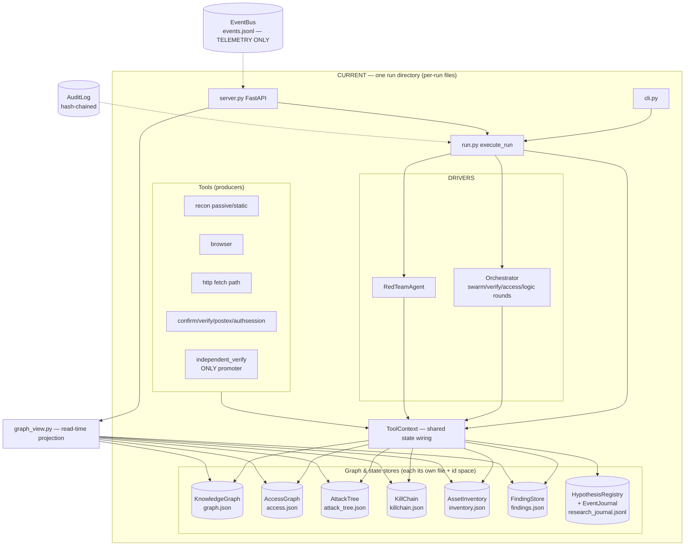
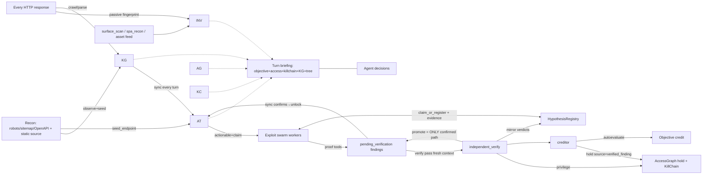
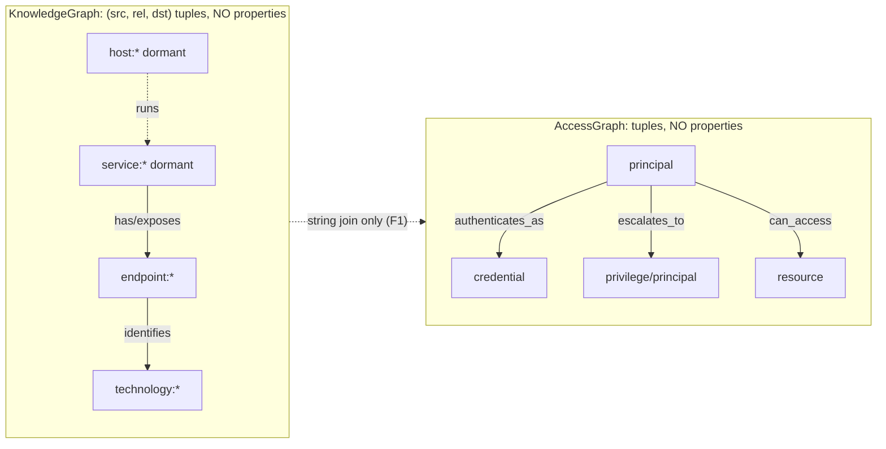
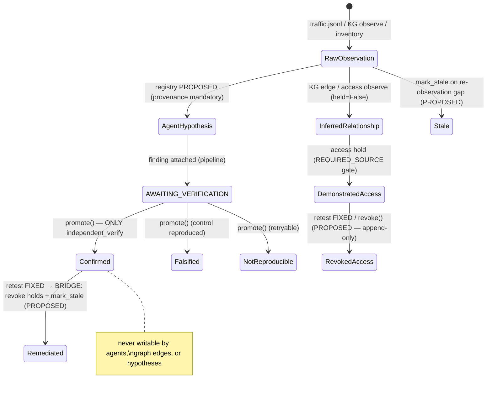
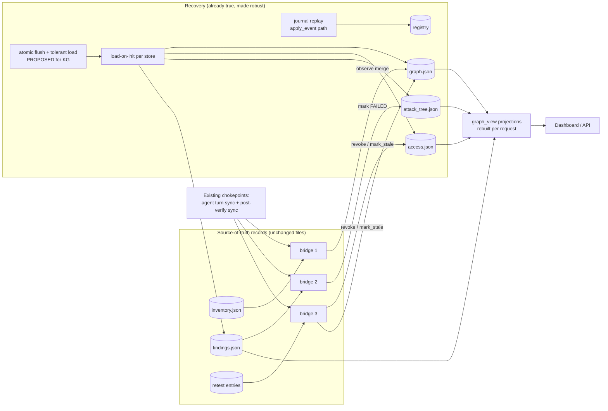

# Builder 02 — Phase 1 Architecture Audit: Unified Attack Intelligence Graph

Repository: `Shivakant2410/Red-Agentic-teams` · Branch `main` · HEAD `b6cdf66`
Status: **AUDIT AND DESIGN ONLY — no source code, configuration, tests, schemas, or runtime behavior was modified.** The only file this audit adds to the working tree is this document (`docs/builder02-phase1-architecture-audit.md`).

---

## 1. Executive summary

The repository does **not** have a unified attack intelligence graph today, and it also does **not** have a wild zoo of disconnected graphs. It has **one dominant target-surface graph (KnowledgeGraph), one demonstrated-access graph (AccessGraph), one execution-planning tree (AttackTree), one progression model (KillChain), one host/service inventory (AssetInventory), one finding store (FindingStore), and one event-sourced hypothesis registry (HypothesisRegistry + EventJournal)** — seven authorities, each internally consistent, each with a clear owner, coordinated procedurally by `Orchestrator`/`RedTeamAgent` through a shared `ToolContext`, and joined only at *read time* (briefings, `graph_view.py`, reports).

The audit's central conclusion: **the platform already has every ingredient of a unified intelligence graph except shared identity, uniform evidence references, invalidation lifecycle, and a synchronization contract.** All four gaps can be closed by *extending the existing stores* — no second graph engine, no graph database, no new event system is justified by the evidence.

Five load-bearing findings (each verified against source, detailed in §16):

- **F1 — Identity is per-store, not global.** The same endpoint exists simultaneously as a KnowledgeGraph node id `endpoint:<url>` (`redteam/knowledge.py:53-54`), an AttackTree node id `<technique>@<url>` (`redteam/attack_tree.py:182-183`), a finding `target` free-text string deduped by `findings.py:109-112` `_norm_target()` (first-token, lowercase, strip trailing `/`), a hypothesis `asset_ref` normalized by `swarm/hypotheses.py:833-844` `normalize_asset()` (scheme-stripped, query/fragment-dropped), and a `graph_view.py:34` asset-layer id that expects KG kinds `{host, service, domain}` — a `domain` kind that **does not exist** in `knowledge.py`. Three divergent URL normalizers already coexist.
- **F2 — The host/service layer of the KnowledgeGraph is dormant.** No code path other than `parsers.ingest()` (`redteam/parsers.py:50-62`, called only from `tools/kali.py:100` on sandbox tool stdout) ever creates a KG `host:` or `service:` node; live HTTP traffic populates `AssetInventory` instead (`tools/http.py:125-142`). The KG docstring's `host -> service -> endpoint` chain (`knowledge.py:6-8`) is structurally supported but usually empty at its root in a browser/probe-only run. Inventory and KnowledgeGraph are **not synchronized in either direction**.
- **F3 — Evidence provenance is strong in the swarm, weak in the graphs.** `swarm.EvidenceRef` (`swarm/hypotheses.py:153-176`) mandates `origin ∈ {agent, target}`, `source_agent`, `artifact_ref`, `ts` — the best provenance model in the repo. KG nodes carry only tool-name labels (`sources: list[str]`, `knowledge.py:46`); AccessGraph nodes carry one free-text `evidence: str` plus a mechanism label `source: str` (`access.py:52-53`); **edges in both graphs are bare tuples `(src, rel, dst)` with zero properties** (`knowledge.py:60`, `access.py:63,118-121`) — no evidence, no confidence, no timestamps, no direction metadata.
- **F4 — There is no invalidation path anywhere.** AccessGraph exposes `observe/hold/link` only — nothing can ever set `held` back to `False`, and no node or edge can be marked stale/revoked/invalidated (`access.py:83-121`). KG has no lifecycle status; AttackTree nodes have no timestamps; `swarm.STALE` exists (`hypotheses.py:55-56`) but is manual-only. A revoked credential, remediated finding (`retest.py` verdict `fixed`), or vanished service leaves every derived structure intact and every old attack path "valid".
- **F5 — Synchronization is pull-based and one-way, with four verified gaps.** Findings→AttackTree, graph→AttackTree, verdicts→hypotheses, and confirmed-findings→access/objective all sync automatically (agent turn / verify pass / creditor). Not synced: **inventory→KG** (never), **falsified findings→AttackTree** (`attack_tree.py:251-252` skips non-confirmed findings; a falsified finding never marks its tree node FAILED), **retest results→access holds** (`retest.py` deliberately never touches `confidence` and nothing downstream reacts), and **endpoint disappearance→any structure**.

The verification/confirmation spine is the strongest part of the architecture and must not be touched: `FindingStore.promote()` is the only writer of `confirmed` (`findings.py:140-157`), called only by `verify_finding_independently` (`tools/independent_verify.py:129`); hypothesis `CONFIRMED/REFUTED` is a mirror requiring an attached finding verdict (`swarm/hypotheses.py:577-611`); access holds are gated by `objective.REQUIRED_SOURCE` (`objective.py:32-37`); the creditor sweeps only confirmed findings (`credit.py:84`).

**Recommendation (smallest coherent architecture):** keep all seven authorities exactly where they are; make the KnowledgeGraph the *unified intelligence backbone in practice* by extending it with (a) one shared canonical-key function, (b) additive evidence-reference fields on nodes and an edge-attribute map, (c) an invalidation lifecycle (`mark_stale` / `revoke`), and (d) two thin idempotent sync bridges (inventory→KG, falsified→tree, retest→revoke) placed inside the existing sync points. Graph views remain read-time projections (`graph_view.py`). Full inventory in §17-§18; test plan in §19; baseline: **1652 passed / 16 skipped / 0 failed** in 48.25 s.

---

## 2. Repository and branch state

| Item | Value |
|---|---|
| Repository | `https://github.com/Shivakant2410/Red-Agentic-teams` |
| Branch | `main` (only branch; `origin/HEAD -> origin/main`) |
| HEAD at audit start | `b6cdf66` — "Merge pull request #10 from Shivakant2410/feat/campaign-brain-b-track-sota" |
| Working tree | clean before audit; after audit, exactly one untracked file: `docs/builder02-phase1-architecture-audit.md` (this document) |
| Package | `redteam-agent` (`pyproject.toml`), Python ≥ 3.10; two top-level packages `redteam/` and `src/agentic_setup/` |
| Docs read | `AGENTS.md`, `GEN2-ARCHITECTURE.md`, `ROADMAP.md`, `docs/adr-001-collective-intelligence-foundation.md`, `README.md` (skim), `PI_GAP_RESEARCH.md` / `PI_INTEGRATION_CATALOG.md` (headers only — PI-specific, not graph-relevant) |
| Test baseline (executed) | `python -m pytest -q` → **1652 passed, 16 skipped, 3 warnings, 0 failed, 48.25 s** (Python 3.12, warnings are sklearn SVD numerics in `test_template_search.py`) |

No ADR other than `adr-001` exists. There is no existing "graph state machine" document; the de-facto state machines live in code (`attack_tree.py:25-25` status constants, `swarm/hypotheses.py:63-71` `VALID_TRANSITIONS`, `findings.py:29-36` confidence vocabulary).

---

## 3. Files inspected

All paths relative to repo root. "Read" = full read of the file in this audit; "Traced" = targeted read/grep of the cited sections.

**Core graph subsystems (read in full):**
`redteam/knowledge.py` (178 L) · `redteam/access.py` (225 L) · `redteam/attack_tree.py` (421 L) · `redteam/killchain.py` (143 L) · `redteam/inventory.py` (146 L) · `redteam/findings.py` (176 L) · `redteam/proof.py` (117 L) · `redteam/verify.py` (133 L) · `redteam/falsify.py` (74 L) · `redteam/graph_view.py` (167 L) · `redteam/events.py` (151 L) · `redteam/objective.py` (224 L) · `redteam/credit.py` (128 L) · `redteam/runtime.py` (165 L)

**Swarm layer (read in full):** `redteam/swarm/__init__.py` (286 L) · `redteam/swarm/journal.py` (150 L) · `redteam/swarm/hypotheses.py` (920 L) · `redteam/swarm/projections.py` (first 60 L + docstring contract) · `redteam/swarm/forum.py` and `redteam/swarm/relationships.py` (method signatures traced; ADR-001 §2.7/§5 cross-checked)

**Integration spine (read in full):** `redteam/run.py` (625 L) · `redteam/orchestrator.py` (1208 L) · `redteam/planner.py` (96 L)

**Recon / inventory producers (read in full):** `redteam/recon/__init__.py` · `redteam/recon/passive.py` (208 L) · `redteam/recon/static_source.py` (traced: writes `ENDPOINT` at :79) · `redteam/importers/assets.py` (163 L) · `redteam/tools/surface.py` (129 L) · `redteam/tools/spa_recon.py` (fold-in section :290-388) · `redteam/tools/http.py` (fetch path :100-179)

**Verification pipeline (read in full):** `redteam/tools/independent_verify.py` (368 L) · `redteam/retest.py` (docstring + verdict vocabulary, 321 L total) · `redteam/tools/verify_tool.py` (graph write :191) · `redteam/tools/confirm.py` (graph writes :211-213) · `redteam/tools/access.py` (`_record` :33-38)

**Security/governance (traced):** `redteam/scope.py` (ScopeGuard :1-80) · `redteam/ratelimit.py` (usage via `run.py:292`) · `redteam/audit.py` (via `run.py:288-290`, `AuditBridge`) · `redteam/memory.py` (structure) · `redteam/bandit.py` (via `attack_tree.py:187-218`, `orchestrator.py:1021-1027`)

**Server / reporting (traced):** `redteam/server.py` (`/api/runs/{id}` :285-312, `/api/runs/{id}/graph` :386-394) · `redteam/report.py` (head :1-50) · `redteam/tools/workflow.py` (`record_finding` :15-53) · `redteam/tools/authsession.py` (`set_session` access writes :47-57) · `redteam/tools/postex.py` (access/killchain writes :87-88, :174-180) · `redteam/pi/killchain.py` (head: separate PI projection) · `redteam/parsers.py` (observation kinds :19-197, `ingest` :236-244) · `redteam/tools/kali.py` (:100 ingest call)

**Tests inspected:** `tests/test_knowledge.py` (49 L) · `tests/test_attack_tree.py` (74 L) · `tests/test_graph_view.py` (162 L) · `tests/test_finding_merge.py` (153 L) · `tests/test_findings_dedup.py` (40 L) · `tests/test_objective_integrity.py` (97 L) · `tests/test_chained_attacks.py` (144 L) · full test directory listing (150 files) + full-suite execution.

**Explicitly NOT inspected line-by-line:** `redteam/llmred/**`, `redteam/pi/**` techniques/oracles (PI capability — read only where it touches the graph: `pi/killchain.py` header, `pi/verify.py` via `independent_verify.py:328-337`), `redteam/sc/**`, `redteam/sid/**`, `redteam/ea/**`, `redteam/oh/**`, `redteam/bench/**`, `dashboard/**`, `src/agentic_setup/**`. This omission is declared, not hidden; none of these packages write the graph stores (verified by grep for `graph.observe`, `access.hold`, `inventory.observe`, `killchain.mark` across `redteam/` — every hit is listed in §12.1).

---

## 4. Current architecture

### 4.1 The assembly line

One run = one directory. `run.py:execute_run(RunOptions)` (`run.py:258-625`) is the only assembly line (CLI and server both call it — `AGENTS.md:65-66`, `GEN2-ARCHITECTURE.md:44-59`). It constructs and wires, in order:

1. `Engagement` load + window check (`run.py:275-277`); scope self-targeting guard when launched from the control plane (`run.py:283-286`).
2. Guards/stores: `AuditLog` (+`AuditBridge`), `FindingStore(out/findings.json)`, `RateLimiter`, `ScopeGuard`, frozen `scope.json` (`run.py:288-310`).
3. **Graph stores:** `KnowledgeGraph(out/graph.json)` (`run.py:314`), `BanditStore(memory/bandit.json)` (cross-run, `run.py:319`), `AttackTree(out/attack_tree.json, bandit=...)` (`run.py:336`), `AccessGraph(out/access.json)` (`run.py:348`), `KillChain(out/killchain.json)` (`run.py:349`), `TrafficRecorder`, `AssetInventory(out/inventory.json)` (`run.py:356-358`).
4. Optional asset feed intersected fail-closed with the RoE into the inventory only (`run.py:363-375` → `importers/assets.py:124-163`).
5. Deterministic recon → KG + AttackTree seeding (`run.py:384-388` → `recon/__init__.py:13-33`).
6. Sandbox/browser/evidence proxy (`run.py:393-438`), then `ToolContext` carrying **all shared state**: `scope, limiter, audit, findings, approve, sandbox, browser, graph, sessions, skills, access, objective, killchain, events, traffic, inventory` (`run.py:444-450`).
7. Driver: `Orchestrator` (multi-agent) or `RedTeamAgent` (single) (`run.py:499-517`); single-agent mode gets the post-run independent verify pass (`run.py:519-531`).
8. Reports from `FindingStore` only (`run.py:574-579`), objective persistence (`run.py:584-590`), manifest + `run.finish` event.

### 4.2 The runtime loop (multi-agent)

`Orchestrator.run()` (`orchestrator.py:962-1101`): RECON round → EXPLOIT rounds (each = swarm of up to `max_swarm_workers` threads claiming `AttackTree.actionable()` nodes via atomic `claim()`, `orchestrator.py:600-753`) → VERIFY pass in a fresh context (`run_verify_pass`, `orchestrator.py:214-263`) → hypothesis verdict mirror (`_mirror_verification_outcomes`, `orchestrator.py:864-901`) → tree sync (`orchestrator.py:1044`) → ACCESS loop while `KillChain.recommend()` names pressing stages (`orchestrator.py:910-953`) → strategy reflection (re-rank only, `orchestrator.py:1103-1192`) → LOGIC round if workflow-shaped (`orchestrator.py:1064-1078`) → final creditor sweep (`orchestrator.py:1082-1086`).

Every agent turn injects a **known-state briefing** assembled from the live stores: objective → access graph → kill chain → planner KG summary → attack tree (after `sync()`), `agent.py:319-341`. This briefing is the *actual* mechanism by which "step 300 knows what step 3 found" — the stores are the memory, the briefing is the read model.

### 4.3 The two event systems (deliberate)

- `EventBus` (`events.py:83-126`): flat `{seq, ts, run_id, type, **payload}`, sink failures swallowed (`events.py:115-120`), per-run `events.jsonl`, replay via `read_events(after=cursor)` (`events.py:59-80`). **Telemetry only** — ADR-001 §2.3 documents exactly why it must not become an authority (unvalidated payloads, no event identity, no duplicate protection).
- `EventJournal` (`swarm/journal.py:52-146`): validated, schema-versioned, UUID-deduplicated, write-failures-raise, engagement-scoped JSONL. **Authority for hypothesis lifecycle only.** Replay through the same `apply_event()` path the live registry uses (`swarm/projections.py` docstring; `swarm/__init__.py:106-118`).
- `AuditLog` (hash-chained, `audit_intact` returned by `execute_run`, `run.py:594,619`): append-only action record — the audit trail authority.

This split is correct and is preserved by the proposal in §17.

---

## 5. Existing graph subsystem inventory

### 5.1 KnowledgeGraph — `redteam/knowledge.py`

- **Data structure:** `_nodes: dict[str, Node]` keyed `f"{kind}:{key}"` (`knowledge.py:53-59`); `_edges: set[tuple[str, str, str]]` — bare `(src, relation, dst)` tuples, no edge identity, no properties (`knowledge.py:60`).
- **Entity types:** `HOST, SERVICE, ENDPOINT, PARAMETER, TECHNOLOGY, CREDENTIAL` constants (`knowledge.py:23-28`). *No* `domain`, *no* `ip`, *no* `vulnerability`, *no* `user/role/permission`, *no* `cloud resource`, *no* `objective` node kinds. Vulnerabilities are represented **indirectly** as endpoint attrs (`attrs={"finding": title}` — `tools/confirm.py:211`, `tools/verify_tool.py:191`, `tools/nuclei.py:150`) and by the per-endpoint `coverage` checklist (`knowledge.py:31-34, 50`).
- **Identity:** `key` is "unique within kind — e.g. the URL, host:port" (`knowledge.py:44`). No normalization is performed at `observe()` time; the caller's string is the key verbatim.
- **Dedup/merge:** re-observation merges attrs, refreshes `last_seen`, appends `source`, and upgrades `confidence` `"observed"→"corroborated"` when a *new* source appears (`knowledge.py:79-99`). This is the dedup/correlation core — and it works (tested: `tests/test_knowledge.py:8-15`).
- **Edges:** created only as a side effect of `observe(relate_to=...)` (`knowledge.py:96-97`); `relation` defaults to `"has"`; an edge whose endpoint nodes exist is silently added to the set; **no duplicate-edge risk exists** (set semantics) but also **no edge metadata ever**.
- **Confidence:** two-valued only (`observed | corroborated`). No verification status, no scope classification, no lifecycle.
- **Persistence:** full JSON rewrite on **every** mutation (`_flush`, `knowledge.py:162-170`) — non-atomic `write_text` (contrast `inventory.py:64-72` and `run.py:73-77`, which use tmp+rename). Load is tolerant of missing file but a corrupt `graph.json` raises `JSONDecodeError` out of `__init__` (`knowledge.py:69-70, 172-178`) — a crash-on-load risk the other stores don't have (`access.py:80-81` and `killchain.py:69-74` swallow parse errors; `inventory.py:56-62` catches them).
- **Thread safety:** single `Lock` around every read and write (`knowledge.py:68, 79, 102-105, 115-117, 119-126`) — consistent-snapshot reads, correct for the swarm.
- **Queries:** `nodes(kind)`, `neighbors(node_id, relation)` (O(E) linear scan), `untested()` (the planner's to-do list), `summary()` (`knowledge.py:115-158`).
- **Cross-run behavior:** per-run file only; no loader merges prior runs; nothing survives except `memory.reflect_app_patterns` digests (`run.py:554-556`).
- **Consumers:** `planner.state_briefing/next_actions` (`planner.py:52-96`), agent briefing (`agent.py:335-337`), `AttackTree.sync` (`attack_tree.py:245-249`), `_looks_workflow_shaped` (`orchestrator.py:91-95`), `graph_view.py:74-93`, `server.py:292-301`.
- **Producers:** full list with call sites in §12.1.

**Verdict:** the KnowledgeGraph *is* the authoritative discovered-surface graph — but only for the endpoint/parameter/technology slice. It is not yet the target-environment graph the docstring claims, because its host/service layer is essentially unpopulated (F2) and nothing else feeds it.

### 5.2 AccessGraph — `redteam/access.py`

- **Node kinds:** `PRINCIPAL, CREDENTIAL, HOST, RESOURCE, PRIVILEGE` (`access.py:32-34`).
- **Edge relations:** `holds, authenticates_as, can_access, escalates_to, pivots_to, reveals` (`access.py:37-38`) — bare tuples again (`access.py:63`).
- **The demonstrated/assumed distinction is real and enforced:** `AccessNode.held: bool = False  # demonstrated, not assumed` (`access.py:50`). `observe()` records existence; `hold()` records possession (`access.py:85-116`). Consumers only trust `held` nodes: `graph_view.py:115` renders held-only, `objective.autoevaluate` iterates `access.held()` (`objective.py:152-179`), `AccessGraph.reached/paths_to/frontier` filter on `held` (`access.py:125-177`).
- **Source gate:** `objective.REQUIRED_SOURCE` (`objective.py:32-37`) restricts which mechanism labels may credit each criterion kind — `privilege` requires `prove_privilege`; `data_access/host_access/flag` require `verified_finding | prove_privilege | try_credential`. `autoevaluate` skips held nodes with a disallowed `source` or empty `evidence` (`objective.py:155-160`). This is the mechanism that prevents an inferred/self-labeled access relationship from becoming objective credit — **it works** (tested: `tests/test_objective_integrity.py`).
- **Weaknesses:** `evidence: str` is one free-text slot, overwritten by later holds (`access.py:113-115`); only `first_seen` exists — **no `last_seen`, no invalidation, no revocation, no expiry**; node `key`s are free-text and not joined to KG/inventory identities (a criterion target `"records"` becomes `resource:records` — `credit.py:35-40, 106-107`); `hold()` overwrites `evidence` even when the new evidence is weaker; the init load swallows corrupt files silently (`access.py:80-81`).
- **`paths_to()` BFS:** from every held node, one shortest path per start (`access.py:138-159`) — intra-graph only; it cannot see KG endpoints, findings, or tree nodes.
- **Persistence:** full rewrite per mutation, non-atomic (`access.py:218-225`); `RLock` for reentrant locked calls (`access.py:65-71`).

**Verdict:** AccessGraph is the correct, specialized demonstrated-access authority. Its weakness is not its model — it's that its identity space (`resource:records`, `principal:admin`) is unjoinable to the target graph and it has no temporal/invalidation dimension.

### 5.3 AttackTree — `redteam/attack_tree.py`

- **Structure:** static `TECHNIQUES` catalog (13 web + 5 PI techniques, `attack_tree.py:41-119`) with `unlocks` chains; dynamic `AttackNode` set keyed `f"{technique}@{target}"` (`attack_tree.py:182-183`). Status: `todo | in_progress | completed | failed` (`attack_tree.py:25`).
- **Classification:** it is a **planning structure + execution queue** (atomic `claim()`, `attack_tree.py:371-384`; bandit-ranked frontier `actionable()`, `attack_tree.py:311-339`), *not* an intelligence graph: nodes carry no evidence, no timestamps, no confidence — only `status`, `findings: str`, `bucket` (bandit shape context).
- **Work-selection authority — must be preserved.** Selection = `actionable()` ranking (static priority + chain boost +100 + bandit Thompson sample ±40 + strategy nudges ±25, `attack_tree.py:324-338`); reflection may only re-rank via `apply_strategy` which "can never create targets, authorize gated actions, or override the chain-boost ordering" (`attack_tree.py:345-369`; GEN2-ARCHITECTURE.md:112-119). The scheduler (`DriftPlusPenaltyScheduler`, `orchestrator.py:301-470`) reorders but "candidates still come ONLY from the tree's actionable frontier" (`orchestrator.py:646-648`).
- **Sync inputs:** `sync(graph, findings)` seeds an entry-technique row per KG endpoint and `confirm()`s techniques matched from confirmed findings via `_CWE_TO_TECHNIQUE` (`attack_tree.py:241-258`). Called every agent turn (`agent.py:339`) and after every verify pass (`orchestrator.py:1044, 1078`).
- **Confirmed finding → unlock:** `mark(COMPLETED)` triggers `_unlock` which spawns chained follow-ups on the same target (`attack_tree.py:262-307`). This is the attack-path *forward* edge — but only within the tree's technique vocabulary.
- **Falsification handling — GAP:** `sync()` explicitly skips every finding whose `confidence != "confirmed"` (`attack_tree.py:251-252`); a falsified finding therefore never marks its `technique@target` node FAILED, and the bandit never learns the loss. Failed attempts DO reach the tree, but only via the swarm's own empty-attempt path (`orchestrator.py:741-742`).
- **Persistence:** JSON list of nodes, full rewrite per mark (`attack_tree.py:416-421`), `RLock`; load from file on init (`attack_tree.py:208-211`).

### 5.4 KillChain — `redteam/killchain.py`

- **Model:** 11 ATT&CK-style stages with descriptions, `GATED = {persistence, defense_evasion}` requiring explicit sign-off (`killchain.py:36-54`); per-stage `StageState(stage, status, notes)` — `not_started | in_progress | achieved` (`killchain.py:57-61`).
- **It is a progression model, not a graph:** no node references, no evidence requirements, no dependency edges between stages. `recommend(access, objective)` (`killchain.py:94-120`) is the decision function that turns holdings + objective distance into "which stage advances us" — it *reads* the AccessGraph and Objective rather than duplicating them.
- **Producers:** only three write paths, all evidence-backed: `tools/authsession.py:56-57` (INITIAL_ACCESS on real session registration), `tools/postex.py:180` (CREDENTIAL_ACCESS on a working credential), `tools/independent_verify.py:354-356` (PRIVILEGE_ESCALATION on an independently confirmed privilege check). No agent-facing tool marks stages directly — good containment.
- **Consumers:** `orchestrator._run_access_loop` gate (`orchestrator.py:931-934`), briefings (`killchain.py:122-131`), dashboard (`server.py:286-289`), `graph_view` metadata (`graph_view.py:152-155`).
- **Overlap with AttackTree:** the technique catalog has `tactic` strings (`attack_tree.py:43-118`) that name kill-chain stages, but **no code maps technique→stage**; the kill chain advances only through the three hand-wired producers above. The two structures model the same campaign from different altitudes without contradicting each other.
- **Second kill chain:** `redteam/pi/killchain.py` is a *separate, mechanical projection* of the PI technique registry onto ATLAS/Hutchins phases (`pi/killchain.py:1-30`). It does not write `killchain.json` and does not touch `KillChain` — a documentation/namespace overlap, not a competing authority.
- **Schema drift (verified):** `StageState` has no `achieved_at` field, yet `server.py:288` and `graph_view.py:153` both read `s.get("achieved_at", "")` from `killchain.json` — both consumers render an always-empty timestamp. Producer/consumer drift, harmless but real.
- **Persistence:** full rewrite per `mark()` (`killchain.py:137-143`); **no lock** — safe today because its three writers are sequential in practice, but it is the only shared store without one (contrast `inventory.py:50`, `access.py:71`, `attack_tree.py:207`, `findings.py:71`).

### 5.5 AssetInventory — `redteam/inventory.py`

- **Model:** `_data["hosts"][host]["services"][f"{scheme}/{port}"]` with `port, scheme, first_seen, hits, last_seen, status_last, server, title, auth, source` (`inventory.py:76-119`). This is the **only** store with `last_seen` + hit counts on the host/service layer, and the only one with atomic saves (`inventory.py:64-72`, tmp+replace).
- **Feeders:** passive fingerprinting of every response on the shared fetch path (`tools/http.py:125-142` `_passive_observe` — zero extra requests); `surface_scan` knocking every allowed host×port (capped 64, `tools/surface.py:31, 59-116`, never records findings); `spa_recon` fold-in (`tools/spa_recon.py:355-358`); asset-feed import (`importers/assets.py:160-161`, intersection-only, `scope.check` re-applied per record, `importers/assets.py:151-158`).
- **Not synced to anything:** the inventory is written and read (RECON briefings, reports `run.py:536-540`, `graph_view.py:96-110`, server) but **nothing propagates inventory state into the KnowledgeGraph or the AttackTree**. `graph_view` bridges the two only at read time — by minting *parallel* ids `asset:{host}` / `asset:{host}/{scheme}/{port}` (`graph_view.py:100-109`) that match nothing in the KG id space (`host:{host}`).
- **No stale handling:** services are never removed or marked absent; `last_seen` is recorded but consumed nowhere.

### 5.6 FindingStore — `redteam/findings.py`

- **Finding model:** title/severity/target/summary/evidence/recommendation/cwe, confidence `tentative | pending_verification | confirmed | falsified | not_reproducible` (`findings.py:29-37`), verification record (`verification_verdict, reproductions, trials`), replay material (`check_type` ∈ http|differential|proof|privilege|workflow|pi_oracle + `check_spec` — `findings.py:46-48`), `independent_verdict`, `retest_history` (`findings.py:49-54`), uuid id + `created` timestamp.
- **Confirmation authority:** `promote()` is the ONLY path that sets `confidence = "confirmed"` (`findings.py:140-157`, docstring: "Only this path may set confidence to 'confirmed' — closing the self-grading loop"). Its only caller is `VerifyFindingIndependentlyTool.run` (`independent_verify.py:129`), which rebuilds the proof from `check_spec` (not narration) and mandates a negative control (`independent_verify.py:1-14, 153-337`). PI findings are re-derived from raw evidence with controls mandated (`independent_verify.py:328-337` → `pi/verify.py:rederive_pi_verdict`).
- **Dedup:** `_norm_target` = first whitespace token, strip trailing `/`, lowercase; same normalized target + same CWE (or same title when no CWE) merges (`findings.py:76-123`). Merge upgrades confidence forward only (`tentative/firm → pending_verification/confirmed`, never resurrecting terminal verdicts — `findings.py:87-99`). Tested: `test_findings_dedup.py`, `test_finding_merge.py`.
- **Retest:** `append_retest` records `{when, verdict ∈ reproducible|fixed|cannot_confirm|blocked, ...}` and "deliberately does NOT touch `confidence`" (`findings.py:159-169`; `retest.py` docstring: verification state = "was it real", retest history = "does it STILL reproduce"). **Nothing downstream consumes a `fixed` retest verdict** — the graph, access holds, and tree are untouched by remediation evidence (F4/F5).
- **Thread safety:** `Lock` on all mutations (`findings.py:70-71`); full-list JSON rewrite per mutation (`findings.py:171-176`).

### 5.7 HypothesisRegistry + EventJournal — `redteam/swarm/`

- **Registry:** event-sourced (`_append_and_apply` = journal first, apply second, `hypotheses.py:645-650`); thread-safe CAS claims with leases (`claim`, `hypotheses.py:406-436`); optimistic versions; lifecycle table `VALID_TRANSITIONS` (`hypotheses.py:63-71`); evidence append-only with mandatory provenance (`EvidenceRef`, `hypotheses.py:153-176`, attachment `hypotheses.py:502-539`); **`record_verification_outcome()` is the only CONFIRMED/REFUTED path and it is a mirror** — it requires the named finding to have been attached as evidence AND the verdict to be in FindingStore vocabulary (`hypotheses.py:577-611`); `set_status` refuses CONFIRMED/REFUTED outright (`hypotheses.py:487-490`).
- **Identity:** full-tuple registration identity `identity_key()` = (normalized asset, weakness, claim, preconditions, expected behavior, boundary, principal, action) (`hypotheses.py:861-879`); same-asset/same-weakness with any differing element is a DISTINCT hypothesis; dedup candidates come only from the advisory relationship layer (`relationships.py` — deterministic signature match + lexical overlap, "candidates only, never authoritative", SUPERSEDES never machine-generated, `hypotheses.py:541-563`).
- **STALE/BLOCKED statuses exist** (`hypotheses.py:55-62`) but nothing sets STALE automatically — it is an operator/agent call.
- **EventJournal:** append-only JSONL, `event_id` UUID dedup, `schema_version`, engagement-scoped (foreign events raise `EngagementMismatchError`, `journal.py:92-101`), write failures RAISE (`journal.py:103-113`), torn-line-tolerant load (`journal.py:122-141`).
- **Replay:** `projections.replay/replay_into` rebuild through the same `apply_event()`; deterministic; duplicate/corrupt/foreign events skipped-and-reported (`ReplayReport`); used for automatic restart recovery via `ResearchBundle.for_run(run_dir=...)` (`swarm/__init__.py:100-118`).
- **Forum:** typed, attributable, quarantined (directive-shaped peer content flagged by swarmguard), secret-redacted, bounded reads; registry stays authority, forum is the communication ledger (ADR-001 §2.2, §5.3).

### 5.8 EventJournal vs EventBus vs AuditLog — authority answer

| Question | Answer |
|---|---|
| Authoritative event history (lifecycle) | `swarm/EventJournal` — hypothesis lifecycle only |
| Authoritative action history | `audit.log.jsonl` (hash-chained; `execute_run` returns `audit_intact`, `run.py:619`) |
| Telemetry fan-out | `EventBus` → `events.jsonl` (never an authority, by design — ADR-001 §2.3) |

### 5.9 Objective — `redteam/objective.py`

Criteria with kinds `data_access | privilege | host_access | flag` (`objective.py:19-24`); `target` names an **AccessGraph node key** (`objective.py:68`); credit paths: agent `claim_objective`, deterministic `autoevaluate(access)` with the REQUIRED_SOURCE gate + evidence_regex fallback under the same gate (`objective.py:122-181`), and the creditor (`credit.py:71-128`, confirmed findings only, idempotent, PRIVILEGE never credited by the creditor). Persisted to `objective.json` post-run (`run.py:584-585`).

---

## 6. Authority and ownership matrix

Every cell verified from source (§5 cites the lines).

| Subsystem | Current authority (owns) | Creates | Updates | Reads | Persists |
|---|---|---|---|---|---|
| **KnowledgeGraph** | Discovered surface: endpoints, parameters, technologies (+ dormant host/service/credential kinds) | `recon/passive.py:192-198`, `recon/static_source.py:79`, `parsers.ingest` via `tools/kali.py:100`, `tools/browser.py:154-167`, `tools/spa_recon.py:350-353`, `tools/nuclei.py:150`, `tools/confirm.py:211`, `tools/verify_tool.py:191`, `tools/access.py:38`, `tools/template_search.py:342`, `tools/skill_tools.py:138` | `observe()` merge (attrs/last_seen/sources/confidence), `mark_coverage` (`tools/confirm.py:213`) | `planner.py:52-96`, `agent.py:335-337`, `attack_tree.sync` (`attack_tree.py:245-249`), `orchestrator.py:91-95`, `graph_view.py:74-93`, `server.py:292-301` | `graph.json` (full rewrite per mutation, `knowledge.py:162-170`) |
| **AccessGraph** | Demonstrated access (`held`) + access edges | `tools/authsession.py:47-54` (set_session), `tools/postex.py:87-88,174-178`, `tools/independent_verify.py:347-353` (privilege confirm), `credit.py:106` (creditor), `tools/access_tools.py:77-85` (record_access — agent, gated downstream) | `observe()` re-observation (attrs/source upgrade `access.py:97-103`), `hold()` evidence overwrite | `objective.autoevaluate` (`objective.py:152-179`), `killchain.recommend` (`killchain.py:94-120`), `agent.py:331-332`, `graph_view.py:112-127` (held only), reports | `access.json` (full rewrite, `access.py:218-225`) |
| **AttackTree** | Attack work selection + execution state | `seed_endpoint` (recon `passive.py:200`, `static_source.py:79` via `recon/__init__.py`, `sync` from KG `attack_tree.py:245-249`), `_unlock` chains | `mark/claim/retry_failed/apply_strategy`; `sync` confirms from findings | swarm claim loop (`orchestrator.py:629-743`), briefing (`agent.py:338-340`), dashboard counts (`server.py:303-309`), reflection digest | `attack_tree.json` (full rewrite, `attack_tree.py:416-421`) |
| **KillChain** | Stage progression | — (no creator; stages init `not_started`) | `mark` from `authsession.py:57`, `postex.py:180`, `independent_verify.py:355` only | `orchestrator._run_access_loop` (`orchestrator.py:931-934`), briefings (`killchain.py:122-131`), `server.py:286-289`, `graph_view.py:152-155` | `killchain.json` (no lock, `killchain.py:137-143`) |
| **AssetInventory** | Host/service/port surface + fingerprints | `tools/http.py:139` (passive, every response), `surface.py:99`, `spa_recon.py:357`, `importers/assets.py:160` | `observe_http/observe_asset` merge (hits, last_seen, banner/title updates) | RECON briefing prompt (`orchestrator.py:118-124` tells the agent to start with surface_scan; inventory summary in reports `run.py:536-540`), `graph_view.py:96-110`, `server.py` inventory route | `inventory.json` (atomic tmp+replace, `inventory.py:64-72`) |
| **FindingStore** | Findings + confidence/verification state | `tools/workflow.py:42-53` (record_finding), `tools/confirm.py`, `tools/verify_tool.py`, `tools/postex.py`, `tools/logic.py`, `tools/access.py:_record`, `importers/nuclei.py`, `pi/runner.py` (pending only) | `add()` merge-forward (`findings.py:76-106`), `promote()` (ONLY via `independent_verify.py:129`), `append_retest` (`retest.py`) | verify worklist (`findings.pending()`), tree sync, creditor, mirror, reports (`report.py`), briefings, dashboard | `findings.json` (full rewrite, `findings.py:171-176`) |
| **HypothesisRegistry** | Hypothesis lifecycle (research layer) | `Orchestrator._research_claim_for_node` → `ResearchBundle.claim_or_register` (`orchestrator.py:767-796`, `swarm/__init__.py:122-160`) | claim/release/renew/evidence/counter-evidence/link/challenge/status; verification MIRROR (`orchestrator.py:864-901`) | `worker_note` briefings (`swarm/__init__.py:176-276`), research summary | `research_journal.jsonl` (append-only) |
| **EventJournal** | Hypothesis lifecycle history (write model; registry is its projection) | every registry mutation | append (idempotent by event_id) | `projections.replay` on restart (`swarm/__init__.py:106-118`) | `research_journal.jsonl` |
| **EventBus** | Nothing — telemetry fan-out (ADR-001 §2.3) | engine/tools/orchestrator emit | — | server SSE/replay, dashboard, bandit sync handler (`run.py:342-344`), forum mirror | `events.jsonl` |
| **Objective** | Criteria credit state | engagement file | `mark` via `autoevaluate` (source-gated) / `claim_objective` / creditor | briefings, kill-chain distance, orchestrator stop condition (`orchestrator.py:999-1002`), scoring | `objective.json` (post-run; live state in memory) |

**Direct answers to the ten authority questions:**

1. **Target asset identity:** split. `AssetInventory` owns host/service identity; KnowledgeGraph owns endpoint/parameter/technology identity. No single owner; no join (F1/F2).
2. **Demonstrated access:** `AccessGraph` (`held` + `source` gate) — sole authority, correctly so.
3. **Attack execution state:** `AttackTree` — sole authority; must remain so (§17).
4. **Finding confidence & confirmation:** `FindingStore` via `promote()`, written only by `verify_finding_independently` — sole authority.
5. **Hypothesis lifecycle:** `HypothesisRegistry` (event-sourced over `EventJournal`) — sole authority.
6. **Evidence provenance:** **split four ways** — swarm `EvidenceRef` (structured), finding `check_spec` (replayable), KG `sources` (labels), access `evidence`/`source` (free text + gate label). No uniform model (F3).
7. **Authoritative event history:** `EventJournal` for hypothesis lifecycle; hash-chained `AuditLog` for actions; `EventBus` explicitly NOT authoritative.
8. **Duplicated representations:** host/service in KG-kind vs inventory (never reconciled); endpoint URL strings duplicated across tree targets / finding targets / hypothesis asset_refs vs KG keys; credential concept in KG `CREDENTIAL` kind vs AccessGraph `CREDENTIAL` kind; kill-chain stage naming in tree tactics vs killchain.py vs `pi/killchain.py`; asset layer re-derived with parallel ids in `graph_view`.
9. **Stores that can become inconsistent:** KG↔inventory (no bridge); AttackTree targets ↔ falsified findings (skipped); AccessGraph holds ↔ retest `fixed` verdicts (no reaction); `graph_view` `domain`/`achieved_at` expectations ↔ actual producer schemas (dead reads).
10. **Already synchronized automatically:** findings+graph→tree (every turn + post-verify), responses→inventory (every fetch), verdicts→hypotheses (post-verify mirror), confirmed findings→access+objective (creditor/iv), KG→tree seeding. The sync pattern exists — it just does not cover the four gaps.

**No new authority is proposed anywhere in §17.** Every recommendation extends an existing owner.

---

## 7. Entity identity audit

### 7.1 Identifier formats in force today (verified)

| Store | Entity | Identity format | Normalization | Source |
|---|---|---|---|---|
| KnowledgeGraph | any node | `kind:key` | **none** — key stored verbatim | `knowledge.py:53-54, 80` |
| KnowledgeGraph | endpoint key | full URL as produced by the discoverer | browser strips `#fragment` (`browser.py:154,163`); spa_recon strips `?query` (`spa_recon.py:347`); passive recon keeps full `urljoin` result (`passive.py:163-170,180-183`); ffuf/dirbust keep full URL (`parsers.py:77-80`) | per-producer |
| AccessGraph | any node | `kind:key` in its own namespace (`principal:session:label`, `resource:records`, `host:web1`) | none | `access.py:55-57`, `credit.py:35-40`, `authsession.py:47-49` |
| AttackTree | node | `<technique>@<target>` where target is a raw endpoint string copied from KG keys or finding targets | none on target | `attack_tree.py:182-183, 222-230` |
| FindingStore | target | free text from the agent | `_norm_target`: first whitespace token, rstrip `/`, lowercase — dedup only, stored value unchanged | `findings.py:109-112` |
| HypothesisRegistry | asset_ref | free text (tree target at registration) | `normalize_asset`: lowercase, strip `https://|http://|//`, drop `?#`, rstrip `/` — **scheme-stripping diverges from KG keys** | `hypotheses.py:833-844` |
| AssetInventory | host/service | `hosts[host]` + `"scheme/port"` | host verbatim (from URL parse); key built from parsed scheme+port | `inventory.py:84-91` |
| graph_view | asset layer | `asset:{host}`, `asset:{host}/{scheme}/{port}`; expects KG kinds `{host,service,domain}` | invented locally; matches neither KG nor inventory ids | `graph_view.py:34, 100-109` |

### 7.2 Concrete duplicate-identity scenarios (traced end-to-end)

- **Same endpoint via passive recon and API discovery:** `recon/passive.py:197` observes `endpoint:https://h/v1/users` (full URL from `urljoin`); later `spa_recon.py:347-350` observes `endpoint:https://h/v1/users` (query stripped). If the URL carries a query string in one source and not the other, these are **two KG nodes** for one endpoint; each seeds its own AttackTree row via `sync` (`attack_tree.py:245-249`) — double testing surface, double WSTG coverage debt. If they agree, the merge path dedups correctly (`knowledge.py:79-99`).
- **Same host in inventory and KG:** inventory records `hosts["203.0.113.5"]` passively on every response (`http.py:139`); KG gets `host:203.0.113.5` **only** if someone runs nmap via `kali_exec` and the output parses (`parsers.py:33-50`, `kali.py:100`). In a browser/probe-only run the KG has *no host node at all* while the inventory has several. Nothing links them.
- **Same user/principal in AccessGraph and identity-related evidence:** `set_session` holds `principal:session:{label}` + `credential:{label}-session` (`authsession.py:47-52`); `try_credential` holds `credential:{value}` and observes `principal:{principal}` (`postex.py:174-178`). The same real identity can appear as `principal:session:admin`, `principal:admin@corp`, and a KG `credential:` node — three spellings, no correlation, and KG-CREDENTIAL vs AccessGraph-CREDENTIAL are different namespaces entirely.
- **Same vulnerability in findings and graph relationships:** a finding's `target` ("https://h/api (IDOR)" prose included — `findings.py:109-111` explicitly tolerates prose) never becomes a graph node; the only graph echo is `attrs={"finding": title}` written **at proposal time** (`confirm.py:211`). After `promote()` the KG still shows the proposal-time attr, with no confirmed/falsified state.
- **Same technique in AttackTree and KillChain:** no mapping exists; the tree's `tactic` strings (`attack_tree.py:43-118`) and kill-chain stages (`killchain.py:36-51`) use the same vocabulary by convention only.
- **Same resource in multiple imported asset feeds:** importer keys `hosts[host].services["scheme/port"]` — re-import merges correctly (`inventory.py:105-119`); but feed-declared services never reach the KG (`importers/assets.py:160` writes inventory only), so the KG-side duplication risk is replaced by a KG-side *absence*.

### 7.3 Normalization rules inventory (the three divergent normalizers)

1. `findings._norm_target` (`findings.py:109-112`): split-whitespace-first-token, rstrip `/`, lowercase. Case-folds but keeps scheme and query.
2. `swarm.normalize_asset` (`hypotheses.py:833-844`): lowercase, strip scheme, drop query+fragment, rstrip `/`. Strips what (1) keeps.
3. `graph_view` finding→endpoint join (`graph_view.py:146-149`): exact match, else query-stripped (`target.split("?")[0]`), against KG keys. Case-sensitive.
4. `swarmguard`/forum `asset_ref` uses registry normalization (2).

**Consequence:** `normalize_asset("https://h/p") = "h/p"` while the KG key is `https://h/p`; the finding dedup key for `https://h/p?x=1` is `https://h/p?x=1` while the KG endpoint from spa_recon is `https://h/p`. Each is internally sound; there is no cross-store equivalent. Case sensitivity: findings/asset normalization lowercases; KG keys and graph_view joins do not — `https://H/P` and `https://h/p` are different KG nodes and the graph_view `proved-by` edge would miss the second.

### 7.4 Foreign keys, dangling edges, merges

- **Dangling edges:** `KnowledgeGraph.neighbors` guards `dst in self._nodes` (`knowledge.py:124-125`) and `observe` only creates edges when `relate_to` already exists (`knowledge.py:96-97`) — the KG cannot accumulate dangling edges through its API, but a hand-edited/partial file load can carry them (they surface as silent no-ops in `neighbors`).
- **AccessGraph edges:** `link()` adds tuples unconditionally (`access.py:118-121`); `graph_view` guards `src/dst in ids` (`graph_view.py:67-70`) — a link to a never-observed node creates an edge that renders nothing and is silently unqueryable via `frontier()` (which does `self._nodes.get(dst)` and skips None, `access.py:173-176`). Not corrupting, but invisible.
- **Entity merge conflicts:** none of the stores has a merge operation. The swarm explicitly refuses merges (relationship candidates only, ADR-001 §5.1). FindingStore merges (dedup) are the only automatic merge in the platform.
- **Engagement-specific vs cross-run identity:** all graph identity is run-scoped. Cross-run state (`bandit.json` keyed `(technique, bucket)` where bucket is an endpoint-*shape*; `memory/experience.json` lessons; `skills.json`) deliberately carries **no target identity** — verified: `bandit.bucket_for_endpoint` derives shape classes, not hosts; memory lessons are tagged prose. This is what makes cross-run reuse safe (§13).

### 7.5 Identity strategy proposal (design only; preserves existing IDs)

Current identifiers are insufficient **only for cross-store joins** — within every store they work and are tested. Therefore:

1. **Do not re-key anything.** `kind:key` in each store remains the primary identity (backward compatible; all tests, dashboards, and persisted files keep working).
2. **Add one canonicalizer, owned by `knowledge.py`** (the surface-graph authority): `canonical_url(url) -> str` (lowercase scheme+host, drop fragment, drop default port, one documented query policy — recommend *drop* to match spa_recon, the strictest existing producer) and `canonical_host(host) -> str`. New observations route through it; existing keys are mapped lazily at read time (`canonical(key)`), so old run data reads fine and new duplicates collapse.
3. **Add foreign-reference attributes, not new id spaces:** AccessNode/AttackNode/f Inventory-service rows gain optional attrs (`kg_endpoint`, `kg_host`) written by the sync bridges (§12.4). Old files load unchanged (all loaders tolerate extra/missing dict keys — `Node(**row)` fields have defaults; `Hypothesis.from_dict` filters unknown keys, `hypotheses.py:211-213`; inventory rows are dicts).
4. **Ownership of canonicalization:** `knowledge.py` owns it because every producer already imports from it and it is the join target for the unified view. Collision handling: canonical merge is exactly today's `observe()` merge (attrs union, sources append, confidence upgrade) — collisions are *corroboration*, not conflicts. Migration: none required (lazy mapping); optional one-shot re-key tool left out of scope.
5. Backward compatibility is preserved by construction: nothing reads `canonical_*` unless the new bridges/view do; every producer keeps writing its native keys.

---

## 8. Graph data model audit

Node/edge properties vs the assignment's checklist. Classification per property: **[working]** exists and is exercised, **[partial]** exists but incomplete, **[derivable]** computable from existing data, **[missing]** absent, **[n/a]** not appropriate for this store.

### 8.1 KnowledgeGraph nodes (`Node`, `knowledge.py:41-50`)

| Property | Status | Notes |
|---|---|---|
| Stable identifier | **[working]** | `kind:key`, set semantics, tested |
| Entity type | **[working]** | 6 kinds; domain/ip/vuln kinds **[missing]** |
| Display name | **[partial]** | `attrs` free-form (title/doc); no dedicated field |
| Engagement/run reference | **[n/a]** | the whole store is per-run (file location IS the run ref) |
| Source | **[partial]** | `sources: list[str]` tool labels — names only, no artifact refs |
| Discovery timestamp | **[working]** | `first_seen` |
| Last observed | **[working]** | `last_seen` refreshed on re-observe |
| Confidence | **[partial]** | `observed|corroborated` only — no verification dimension |
| Verification status | **[missing]** | finding state lives only in FindingStore; KG attr written once at proposal |
| Scope classification | **[derivable]** | everything in KG was scope-checked en route (ScopeGuard); not stored |
| Metadata | **[working]** | `attrs` dict |
| Evidence references | **[missing]** | labels only; no `artifact_ref` (traffic.jsonl seq, events seq) |
| Lifecycle status | **[missing]** | no stale/removed marking; deletion never happens (good) |

### 8.2 Edge properties (both graphs — `knowledge.py:60`, `access.py:63,118-121`)

| Property | Status |
|---|---|
| Stable identifier | **[missing]** — bare tuples; identity IS the triple |
| Source/destination | **[working]** |
| Relationship type | **[working]** (KG free-form string; AccessGraph 6 constants) |
| Evidence references | **[missing]** |
| Provenance | **[missing]** |
| Confidence | **[missing]** |
| First/last observed | **[missing]** |
| Verification status | **[missing]** |
| Direction | **[working, implicit]** — tuples are ordered |
| Validity / invalidation reason | **[missing]** |

This is the single largest schema gap: **an edge in this platform cannot say who claimed it, when, or on what evidence.** The distinction between facts/hypotheses/inferred/demonstrated relationships exists *between stores* (KG=observed facts, swarm=hypotheses, AccessGraph `held`=demonstrated, `observe()`-only=inferred) — the audit's recommendation is to keep that distinction **between stores** (it is enforced by the source gates) rather than flatten everything into one generic edge list with a `kind` flag, which would weaken the REQUIRED_SOURCE and held/observe guarantees.

### 8.3 AccessGraph nodes (`AccessNode`, `access.py:45-57`)

Stable id **[working]**; kind **[working]** (5 kinds); display name n/a (key IS the label); run ref n/a; source **[working — load-bearing]** (REQUIRED_SOURCE gate); discovery ts **[working]** (`first_seen`); last observed **[missing]**; confidence **[n/a]** — `held` boolean is the real confidence axis; verification status **[partial]** — implied by `source ∈ {verified_finding, prove_privilege, try_credential}`; metadata **[working]** (`attrs`); evidence refs **[missing]** (single `evidence: str`); lifecycle **[missing]** (no revoke/stale/expiry).

### 8.4 AttackTree nodes (`AttackNode`, `attack_tree.py:173-183`)

Stable id **[working]**; technique **[working]**; target **[partial]** (raw string, no type); status **[working]**; findings association **[partial]** (`findings: str` set via `mark(..., findings=...)` — free text, not finding IDs); bucket **[working]**; timestamps **[missing]**; evidence refs **[missing]**; dependencies **[working]** (static `unlocks` in the catalog, materialized dynamically by `_unlock`); prioritization **[working]** (priority table + chain boost + bandit + strategy nudges); claiming/ownership **[working]** (atomic `claim`, tested); completion criteria **[working]** (finding-confirmation via `sync`); retry **[working]** (`retry_failed`, once per round, `attack_tree.py:285-301`).

### 8.5 What the model already gets right (do not "fix")

- Set-based edges ⇒ duplicate-edge creation is structurally impossible.
- Per-store verification vocabulary mirrors (finding confidence ↔ hypothesis status ↔ access `source`) keep the trust model enforceable in one place each.
- The swarm's evidence model is the template any new evidence field should copy (`EvidenceRef` shape) — not a new invention.

---

## 9. Evidence provenance and trust model

### 9.1 Can the platform answer the provenance questions today?

| Question | Answer today | Evidence |
|---|---|---|
| Who discovered an asset? | **Yes, partially** — KG `sources` (tool labels); inventory `source` field; access `source` | `knowledge.py:46`, `inventory.py:90,102`, `access.py:53` |
| Which tool produced the observation? | **Yes** — audit log + traffic log record tool labels per exchange | `tools/http.py:177` (`tool=` label), `traffic.py` |
| Which agent performed the action? | **Yes** — audit + events carry agent identities (`exploit-w0`, roles); forum/hypothesis records `source_agent` | `orchestrator.py:571-579,704-715`, `hypotheses.py:153-176` |
| When was it observed? | **Yes** in KG/inventory/findings/registry; **No** in AccessGraph edges (node `first_seen` only) and AttackTree (no timestamps) | §8 |
| Which engagement/run produced it? | **Yes** — per-run directories; events carry `run_id`; journal carries `engagement_id` | `run.py:269-270`, `events.py:110`, `journal.py:35-36` |
| What evidence supports the relationship? | **Finding/holding-level yes** (`check_spec`, access `evidence` str); **edge-level no** | §8.2 |
| Was the evidence independently verified? | **Yes for findings and anything derived from confirmed findings** — the entire promotion chain | `findings.py:140-157`, `independent_verify.py` |
| Has the evidence become stale? | **Partially** — KG/inventory `last_seen` recorded but consumed nowhere; retest history exists but drives nothing downstream | §10 |
| Has contradictory evidence appeared? | **Yes in the swarm** (counter-evidence, challenges, CONTRADICTS candidates); **No in the graphs** | `hypotheses.py:507-510, 565-575`, `relationships.py:105-122` |
| Inferred vs directly demonstrated? | **Yes, by store contract** — KG `observe`=inferred observation, AccessGraph `hold`+`source`=demonstrated, swarm=agent hypothesis; gates enforce it | `access.py:87-94`, `objective.py:32-37` |
| Can the result be reproduced? | **Yes for confirmed findings** — deterministic `check_spec` replay + negative control, no LLM | `independent_verify.py:1-14`, `retest.py:1-60` |

### 9.2 The existing trust ladder (verified, and it holds)

The repo's central principle — "an observation is not a hypothesis; a hypothesis is not a finding; a finding is not confirmed until the independent verification pipeline confirms it" (ADR-001 §1, `swarm/__init__.py:5-7`) — maps to a concrete nine-state ladder:

1. **Raw observation** — traffic.jsonl line / KG node with source label / inventory row. Immutable evidence plane.
2. **Agent hypothesis** — HypothesisRegistry `PROPOSED/ACTIVE` (never touches confidence anywhere).
3. **Inferred relationship** — KG edge / AccessGraph `observe()`-only node (`held=False`).
4. **Demonstrated relationship** — AccessGraph `hold()` with gate-approved `source` + evidence.
5. **Recorded finding** — `tentative` (agent-asserted, `record_finding`) or `pending_verification` (k-of-n self-check passed — `tools/confirm.py`, `verify.py`).
6. **Pending verification** — explicit state; visible to the VERIFY worklist only (`findings.py:134-138`).
7. **Independently confirmed** — `promote()` only; unlocks: objective credit, access holds, kill-chain stage, tree completion, skill capture (`independent_verify.py:136-156, 341-368`, `credit.py`).
8. **Falsified / not_reproducible** — terminal-or-retryable per state (`independent_verify.py:97-107` keeps not_reproducible appealable); never counts toward anything (`findings.py:33-36`).
9. **Stale/invalidated** — **not implemented anywhere** (F4). The ladder's missing rung.

**The graph cannot promote a finding today, and nothing in the proposal changes that.** The one subtle trust risk found: `FindingStore.add()` merge upgrades a `tentative` record to `pending_verification/confirmed` when a proof lands on it (`findings.py:87-99`) — correct (the proof pipeline produced the higher state), and terminal verdicts cannot be overwritten or resurrected. No path was found where an agent belief, hypothesis, or graph edge changes finding confidence. The mirror direction is enforced in code (`hypotheses.py:577-599` raises unless the finding was attached AND the verdict came from the pipeline vocabulary).

### 9.3 Proposed evidence-reference model (design)

Adopt `EvidenceRef`'s shape as the **one evidence-reference contract** across stores — as an *additive field*, not a new subsystem:

```python
# shape (already exists in swarm/hypotheses.py:153-176 — reuse, do not re-invent):
{"origin": "agent|target", "source": "<tool or agent name>",
 "artifact_ref": "<traffic.jsonl line | events.jsonl seq | finding id | node:id>",
 "kind": "observation|tool_result|finding|attempt|control", "ts": "<iso>"}
```

- KG `Node` gains `evidence_refs: list[dict]` (default `[]`) — appended by the existing producers' write paths (they already know the tool name and the traffic/audit context).
- AccessGraph nodes gain `evidence_refs` alongside the existing `evidence: str` (the string stays — REQUIRED_SOURCE display and tests depend on it).
- Edges: KG/access gain a parallel `edge_attrs: dict[tuple, dict]` (keyed by the existing triple) carrying `{evidence_refs, first_seen, last_seen, confidence}` — tuples stay valid, `_load` still builds tuples, old files load fine.
- Provenance rules (preserve existing): `origin="target"` content can never be relabeled (`hypotheses.py:516-519` precedent); evidence is append-only; summaries bounded; secrets redacted at the traffic layer already (`traffic.py` masking both ways).

---

## 10. Temporal intelligence and stale data

### 10.1 What each store records today

| Store | Timestamps | On re-observation | On disappearance | On revocation |
|---|---|---|---|---|
| KnowledgeGraph | `first_seen`, `last_seen` | attrs merged, `last_seen` bumped (`knowledge.py:88-90`) | nothing — node persists forever | n/a (no lifecycle) |
| AccessGraph | `first_seen` only | attrs/source merged (`access.py:97-103`) | nothing | **impossible** — no API (`access.py:83-121`) |
| AttackTree | none | status transitions only | node persists | FAILED is per-round retry, not invalidation |
| AssetInventory | `first_seen`, `last_seen`, `hits`, `status_last` | bumped every response (`inventory.py:92-99`) | nothing | n/a |
| FindingStore | `created`, retest `when` entries | trials/reproductions updated | terminal states persist (deliberate) | falsified = the record |
| HypothesisRegistry | full event `ts`, `created_at/updated_at`, lease expiry | versioned events | STALE status (manual) | terminal states immutable |
| KillChain | none (`achieved_at` read by consumers but never written) | status overwrite | n/a | n/a |

### 10.2 The temporal gaps and their consequences (verified)

- **Removed assets / changed IPs / changed services:** inventory `last_seen` updates but nothing reads it; KG endpoints never expire; the AttackTree keeps TODO rows for endpoints that stopped answering. A dead endpoint remains "attackable work" in every later round.
- **Removed endpoints:** same as above; `graph_view` will still render the old chain.
- **Changed technology fingerprints:** KG attr merge overwrites (`attrs[k]=v`, `knowledge.py:88-89`) — current value wins, history lost (acceptable), but no "changed at" marker exists to invalidate downstream conclusions.
- **Changed permissions / revoked credentials / expired access:** `AccessGraph.hold()` has no inverse. `set_session` holds persist for the run; nothing models expiry. `try_credential` failures do NOT un-hold a previously working credential (`postex.py:174-180` has no failure path touching access). **A session that died mid-run still reads as "[ACCESS HELD]" in every subsequent briefing** (`access.py:181-208`).
- **Remediated vulnerabilities:** `retest.py` produces `fixed` verdicts into `retest_history` — and *nothing* consumes them: no KG coverage reset, no access-hold revoke, no tree note, no event. The finding's `confidence` stays `confirmed` (correct — it *was* real), but the platform will present a remediated hole as a live one.
- **Findings that no longer reproduce:** `not_reproducible` is retryable by design (`independent_verify.py:97-107`) — good. But no re-verification schedule exists; a confirmed finding is never re-checked automatically.
- **Conflicting observations across runs:** impossible by design (per-run stores) and handled *within* the swarm via counter-evidence/challenges. Cross-run conflict surfaces only through the bandit's aggregate statistics.

### 10.3 Current-vs-historical representation

The platform represents **accumulated observations**, not a current-state snapshot: `first_seen`/`last_seen` exist in the two stores that matter most (KG, inventory) and are simply unused for aging. Historical evidence is never deleted (correct — auditability is a stated differentiator, `ROADMAP.md:26-28`). Proposal (design only):

1. **Do not delete history.** Add a *validity layer* instead: KG `mark_stale(key, reason)` sets `attrs["lifecycle"]="stale"` + `stale_at`; AccessGraph `revoke(kind, key, reason)` sets `held=False`, `invalidated_at`, `invalidation_reason` — **append-only semantics preserved** (the hold happened; the revoke is a new fact).
2. **Old access ≠ current access:** `autoevaluate`/creditor already require evidence; add the rule that a hold whose `source`-finding has a later `fixed`/`falsified` retest or whose node is revoked cannot satisfy a criterion (enforced at the same gate, `objective.py:152-179`).
3. **Confirmed ≠ currently exploitable:** keep `confidence` untouched (correct axis separation, `findings.py:159-169`); derived views (`graph_view`, reports) gain a "last retest verdict" decoration computed from `retest_history` — read-time, no new state.
4. **Timestamp policy:** every observation event already gets UTC ISO-8601 (`_now()` in all stores); standardize on "last_observed" as the staleness key and drive staleness off *re-observation*, not wall-clock decay (a service not re-observed for N rounds is stale-candidate; N is an open decision, §21).

---

## 11. Attack path and intelligence relationships

### 11.1 What each structure contributes to an attack path today

- **Target assets/services:** AssetInventory (`scheme://host:port`) + KG (endpoint layer only).
- **Vulnerabilities:** FindingStore records (`target` + `cwe` + confidence); KG only echoes proposal-time attrs.
- **Techniques:** AttackTree (`technique@target`, status, unlock chains).
- **Access prerequisites:** AttackTree `unlocks` (technique-level, static catalog) and swarm hypothesis `preconditions` (free text).
- **Demonstrated access:** AccessGraph `held` nodes + edges (`authenticates_as`, `escalates_to`, ...).
- **Credentials/privileges:** AccessGraph kinds.
- **Findings:** FindingStore + the `proved-by` edge graph_view mints at read time (`graph_view.py:143-149`).
- **Objectives:** criteria with `target` = access-node key; distance via `AccessGraph.distance_to` (`access.py:161-166`).

### 11.2 Can the four graphs collectively describe an attack path? Verified answer

**Within** each structure, yes; **across** them, only via fragile string joins:

- `graph_view.build_exploration_graph` is the one place the chain asset→endpoint→access→finding is assembled (read-time, from files, honest-by-construction: held-only access, real confidence, `proved-by` only when the endpoint actually exists — `graph_view.py:1-23, 112-149`). It demonstrates the projection pattern works.
- The joins it performs are the weak points: KG-edge reuse (works — same id space), inventory-id minting (parallel id space, §7.1), finding→endpoint match by exact-or-query-stripped string (`graph_view.py:146-149`), access edges rendered only between held nodes (`graph_view.py:120-127`).
- `AccessGraph.paths_to` gives hop counts from holdings to objective targets (`access.py:138-166`) but cannot route *through* a KG endpoint or a confirmed finding — a path "hold principal:session:s0 → can_access → resource:/admin" exists, while the much richer story "endpoint /admin has CWE-284 confirmed by finding abc123, replayable via check_spec" lives in three other files.

### 11.3 Missing pieces (each verified, each mapped to a proposal in §17)

| Missing | Where it bites | Proposal target |
|---|---|---|
| Cross-graph references | every view/join | §7.5 foreign-ref attrs |
| Consistent entity IDs | double endpoints, double tree rows | §7.5 canonicalizer |
| Evidence-backed transitions | tree unlock edges, access edges | §8.2/§9.3 edge attrs |
| Explicit prerequisites | swarm preconditions are prose | extend hypothesis preconditions usage, not new structure |
| Reachability across stores | paths_to is intra-graph | §11.4 projection |
| Confidence/verification on paths | views show raw edges | graph_view decoration (already honest on findings) |
| Remediation impact | `fixed` retest changes nothing | §10.3 rule 2 |
| Stale path invalidation | revoked access keeps paths alive | §10.3 rule 1 + graph_view filters revoked |
| Explainable path provenance | scattered evidence | §9.3 evidence refs surface into the view |

### 11.4 Attack-path view proposal (read-time projection; no new authority)

Extend `graph_view.build_exploration_graph` with an `attack_paths` section assembled purely from existing files: for each confirmed finding → its tree node (`technique@target` when the target matches canonically) → the KG endpoint → the inventory service → any access holds sourced from it (`credit.py` writes `evidence="confirmed finding {id}..."`, which is parseable and already stored) → the objective criteria it satisfied (objective.json `evidence` strings embed finding ids, `credit.py:103-105`). Every hop carries its evidence refs and verification state. **This is bounded by scope by construction** — every input artifact was produced under the RoE — and it cannot authorize or trigger anything: it is a file-reading adapter served over GET, exactly like the existing exploration graph (`server.py:386-394`).

**Authority boundaries preserved (explicit):** the AttackTree keeps work selection; AccessGraph keeps demonstrated access; FindingStore keeps confirmation; KillChain keeps progression; KnowledgeGraph does not silently absorb any of them — the path view is a *projection*, matching the repo's own invariant ("graph views are projections of authoritative records", GEN2-ARCHITECTURE.md:201-208).

---

## 12. Synchronization and consistency analysis

### 12.1 Actual data flow (Discovery → … → Objective), with call paths

```
Discovery
  ├─ deterministic recon (run.py:384-388 → recon/passive.py:192-200)
  │     → KG.observe(ENDPOINT/TECHNOLOGY) + AttackTree.seed_endpoint        [direct sync]
  ├─ static source (recon/__init__.py:25-33 → static_source.py:79)
  │     → KG.observe(ENDPOINT) + seed_endpoint                              [direct sync]
  ├─ every HTTP response (tools/http.py:177-179 → _passive_observe :125-142)
  │     → Inventory.observe_http                                            [direct sync, passive]
  ├─ browser crawl (tools/browser.py:154-167) → KG endpoints/parameters     [direct sync]
  ├─ surface_scan (tools/surface.py:99-109) → Inventory + "asset.discovered" event [direct + event]
  ├─ spa_recon (tools/spa_recon.py:350-358) → KG endpoints + Inventory      [direct sync]
  └─ kali_exec output (tools/kali.py:100 → parsers.ingest :236-244) → KG    [direct sync]

Graph update → hypothesis creation
  └─ AttackTree.actionable() (orchestrator.py:637) → claim (orchestrator.py:656-663)
        → ResearchBundle.claim_or_register (orchestrator.py:767-796)        [direct sync]
        → worker_note briefing into the specialist prompt (orchestrator.py:703,713-715)

Execution → evidence
  └─ proof tools → FindingStore.add (pending_verification) + KG attr + coverage
        (tools/confirm.py:211-213, tools/verify_tool.py:191)                [direct sync]
        + swarm evidence attach + AWAITING_VERIFICATION (orchestrator.py:809-858)

Verification
  └─ run_verify_pass fresh context (orchestrator.py:214-263)
        → verify_finding_independently → FindingStore.promote               [the ONLY confirm path]
        → access holds + killchain (privilege) + skills (independent_verify.py:341-368)
        → creditor sweep (orchestrator.py:256-262 → credit.py:71-128) → objective.autoevaluate
        → hypothesis mirror (orchestrator.py:864-901)                        [event-driven-ish, pull]
        → attack_tree.sync (orchestrator.py:1044) → confirm → _unlock        [direct sync]

Objective evaluation
  └─ objective.autoevaluate(access) every agent turn (agent.py:325-328)
        + creditor post-verify (credit.py:106-108)                           [pull]
```

### 12.2 Connection classification

| Connection | Classification |
|---|---|
| recon → KG → AttackTree | Direct synchronous update |
| every response → Inventory | Direct synchronous update (passive) |
| findings → AttackTree (confirm) | Direct synchronous update (pull via `sync` on turn/verify) |
| finding verdicts → HypothesisRegistry | Pull-based mirror at verify-pass boundary (not event-driven) |
| confirmed finding → AccessGraph/KillChain/Objective | Direct synchronous (inside the verify tool + creditor) |
| asset feed → Inventory | Manual import (run-start), intersection-gated |
| Inventory → KG | **Missing integration** |
| falsified findings → AttackTree | **Missing integration** (skipped at `attack_tree.py:251-252`) |
| retest `fixed` → AccessGraph/KG/tree | **Missing integration** |
| endpoint disappearance → any store | **Missing integration** (no staleness anywhere) |
| EventBus → stores | **One-way telemetry only** (no store rebuilds from events; bandit sync handler is the sole stateful subscriber, `run.py:342-344`) |
| KG → graph_view / server | Read-time projection |
| forum → EventBus | Event-driven mirror, best-effort (ADR-001 §2.2) |

### 12.3 Consistency problems (from the assignment's list, each verified or ruled out)

| Claimed problem | Verdict | Evidence |
|---|---|---|
| Finding confirmed but graph not updated | **Partial** — KG got a proposal-time attr only; no confirmed-state ever lands on the node; coverage marked at proposal, not confirmation | `confirm.py:211-213` vs `promote()` |
| Asset discovered but graph doesn't know | **True for inventory** — host/service layer never reaches KG | `http.py:139` has no KG write |
| Access edge invalidated but attack paths still reference it | **Invalidation itself is impossible today** — the deeper version of the problem | `access.py:83-121` |
| Hypothesis falsified but dependent relationship remains active | **Contained** — REFUTED is terminal, relationships persist as history (append-only by design); no downstream structure depends on hypothesis status except briefings | `hypotheses.py:63-71` |
| Service disappears but old attack path remains available | **True** — no staleness anywhere | §10.2 |
| Remediation event does not invalidate dependent attack paths | **True** — `fixed` retest drives nothing | `findings.py:159-169` + grep: no consumer of `retest_history` outside report |

### 12.4 Synchronization architecture proposal (no competing event system)

**Principle: keep the repo's proven pull-based sync; widen its coverage; make every step idempotent.** The EventBus stays telemetry (ADR-001 §2.3 verdict stands); the EventJournal stays hypothesis-scoped. Source-of-truth records remain the stores; everything new is either (a) a store method, or (b) a read-time projection.

1. **Inventory→KG bridge** (one function, called where `sync()` already runs — `orchestrator.py:1044` and `agent.py:339` are the existing chokepoints): for each inventory host/service without a KG node, `graph.observe(HOST/SERVICE, ...)` with `source="inventory"` and a foreign-ref attr. Idempotent by the merge semantics (`knowledge.py:79-99`). This single bridge makes the KG docstring's `host → service → endpoint` chain true in practice and fixes the F2 dormancy without touching any producer.
2. **Falsified→tree bridge**: extend `AttackTree.sync` (or the post-verify call site) to mark `FAILED` on `technique@target` when a finding targeting it is `falsified` — feeding the bandit its loss and pruning the frontier, symmetric with the confirmed path. The same-status idempotency guard already exists (`attack_tree.py:265-272`).
3. **Retest→revoke bridge**: `retest.py` verdict `fixed` (and `blocked` for the finding's own holds) triggers `AccessGraph.revoke` on holds whose evidence references the finding id (the creditor writes findable evidence strings, `credit.py:103-105`) + KG `mark_stale` on the endpoint's coverage. All append-only.
4. **Stale sweep** (optional, roundly bounded): at the same chokepoint, endpoints whose inventory service hasn't answered for K rounds get `mark_stale` (design decision K≥2, §21); STALE hypotheses can then be set via the existing validated transition (`hypotheses.py:466-500`) — automatic setting of STALE is deliberately *not* proposed (it's an agent/operator judgment; the plumbing exists).
5. **Idempotency & replay:** every bridge is either a set-add, a merge (`observe`), or a guarded transition (same-status no-op) — replaying a round twice changes nothing. Deterministic reconstruction of derived views already exists for the swarm (`projections.py`); the graph projections (`graph_view`) are rebuilt from files on every request (`server.py:386-394`), so they are replay-safe by construction. **No journal for KG/access is proposed** — their file-per-mutation persistence already reconstructs state after a crash (load-on-init, `knowledge.py:69-70`, `access.py:72-81`, `attack_tree.py:208-211`), which is the same recovery contract the tree/findings already honor (`runtime.py:8-11`).

---

## 13. Cross-run and engagement isolation

Verified scoping facts:

- **Graphs are per-run.** Every graph store's path is under `out_dir` (`run.py:288-358`); nothing loads a previous run's graph (grep for cross-run graph reads: only `server.py`/`graph_view.py`/`cli.py` read their *own* run dir for serving).
- **Findings/hypotheses are run-scoped.** `findings.json` per run; registry `engagement_id` fixed at construction and stamped on every record; journal refuses foreign engagement events (`journal.py:98-101`); forum `_load` skips foreign rows (`ADR-001 §5.3`); "no global registry exists" (`hypotheses.py:30-32`).
- **Cross-run shared state is deliberately aggregate and target-blind:** `bandit.json` (technique×shape win rates — `run.py:315-318`, bucket = endpoint shape, not host), `memory/experience.json` (tagged lessons; poisoned-content resistant, `memory.py:16-100`), `skills.json` (proof recipes), EPSS/KEV priors (class-level, "never target-linked", `run.py:324-334`). **No target identity, no findings, no graph content crosses runs.**
- **Data cannot leak across engagements** at the store level (per-run dirs, engagement-scoped registry). The server serves runs by id from `--runs-root` with no cross-run query endpoint (traced `server.py` routes).
- **Historical observations accessible to later runs:** only as distilled patterns (`reflect_app_patterns`, `run.py:554-556`) and learned lessons — i.e., intelligence without identity. This is the correct shape; a full cross-run graph merge is *not* proposed (it would create the cross-engagement authority problem the current design avoids).
- **Scope boundaries:** the RoE is frozen per run (`scope.json`, `run.py:299-310`); the asset-feed importer is an intersection and "scope is NEVER widened" (`importers/assets.py:1-21, 151-158`); historical intelligence cannot expand scope because it carries no scope and every new network touch re-checks ScopeGuard (`recon/passive.py:40-49`, `http.py:103-122`); retests rebuild the RoE from `scope.json` alone and refuse out-of-RoE replay as `blocked` (`retest.py:33-38`).

**Proposal:** preserve this exactly. Cross-run intelligence enrichment (a later-run KG seeded with prior-run *facts* for the same engagement) is listed as an open decision (§21-O5) precisely because it risks turning old observations into current authorization; if ever built, it must import as `origin="historical"`, never `held`, never scope-widening, and re-verified before any credit — consistent with §10.3's rule that an old success is not current proof.

---

## 14. Performance and scalability assessment

**All figures below are structural analysis. No benchmarks were run; performance is UNMEASURED** (the repo has no graph benchmarks; `benchmarks/` targets swarm methodology).

| Area | Structure | Cost | Risk assessment |
|---|---|---|---|
| Node/edge storage | dicts + tuple sets, in-memory | O(1) upsert, O(E) neighbor scan (`knowledge.py:119-126`) | fine to thousands of nodes |
| Persistence | **full JSON rewrite on every mutation** (KG `knowledge.py:162-170`; access `access.py:218-225`; tree `attack_tree.py:416-421`; findings `findings.py:171-176`) | O(N) per write, O(N·M) cumulative over a run | the dominant scaling cost; a 10k-node graph rewrites ~10k rows per observe; inventory alone uses atomic tmp+rename (`inventory.py:64-72`), the others don't |
| Load | full-file JSON parse on init | O(N) once | corrupt-file behavior diverges: KG raises (`knowledge.py:69-70`), access/killchain swallow (`access.py:80-81`), inventory catches (`inventory.py:56-62`) |
| Queries | `untested()` O(N), `paths_to` O(held·(V+E)) BFS per round | bounded by graph size | fine |
| Lock contention | one lock per store; swarm = ≤3 workers (`orchestrator.py:503-508`) | short critical sections; `EventBus` fans out outside its lock (`events.py:113-115`) | low; thread-safety tested (`test_shared_state_thread_safety.py`) |
| Duplicate edges | set semantics | none | — |
| Event replay | journal replay O(events) at startup; `events.jsonl` read is cursor-bounded (`events.py:59-80`) | grows with run length | ADR-001 §5.6 already flags journal size ("revisit if journals exceed tens of MB") |
| Cross-run loading | none exists | — | — |
| Large inventories | inventory summary caps endpoints at 64 (`inventory.py:140-141`); surface scan caps at 64 pairs (`surface.py:31`) | bounded | — |
| Finding collections | dedup is O(N) linear scan per add (`findings.py:114-123`) | O(N²) cumulative | fine at realistic finding counts (<hundreds) |

**Measurable targets to validate *before* any optimization** (proposed, not measured): (T1) 5k-endpoint synthetic KG — `observe` p95 < 5 ms, full-run flush overhead < 5% of wall clock; (T2) 2k-node tree — `actionable()` p95 < 10 ms under 3 workers; (T3) 50 MB journal — replay < 10 s; (T4) report build with 500 findings < 2 s. If T1 fails first, the fix is batched/atomic flushes (the inventory pattern), **not** a graph database — the current storage model meets the platform's actual needs (single process, ≤3 workers, run-scoped data, file-served dashboards).

---

## 15. Security and governance assessment

Every control in the assignment list was located and traced:

| Control | Location | Verified behavior |
|---|---|---|
| ScopeGuard | `scope.py:70-80` + every network path (`recon/passive.py:40-49`, `tools/http.py:103-122`, `surface.py:91-93`, `spa_recon.py:296-299, 338-341`, browser, proxy) | fail-closed hostname+IP double check; denials are *recorded evidence* (`http.py:103-122`) |
| Engagement config/window | `run.py:275-277` (inactive window aborts); frozen `scope.json` per run (`run.py:299-310`) | RoE drift between runs doesn't leak into retests (`retest.py:33-38`) |
| RateLimiter / budget | `ratelimit.py` via `run.py:292`; BudgetTracker (`runtime.py:77-123`) incl. kill file | surface_scan stops honestly on budget exhaustion (`surface.py:83-89`) |
| Sandbox egress | `sandbox/egress.py`, `entrypoint.sh` (fail-closed), self-test tears down on escape (`run.py:427-428`); `kali_exec` refuses firewall-tampering (`AGENTS.md:235-236`) | network-layer, not prompt-layer |
| Approvals | interactive or `HeadlessApprover` (`run.py:80-130`); destructive/DoS-shaped gated (`tools/confirm.py`, `workflow.request_approval`) | STOP kill file auto-denies pending approvals (fail closed, `run.py:114-118`) |
| Kill switch | `STOP` file → `BudgetTracker.check` raises `Halt` (`runtime.py:109-111`) | clean unwind |
| Asset-feed scope intersection | `importers/assets.py:124-163` — re-runs `scope.check` per record; drops+counts; ValueError on unreadable feed | importing cannot widen the RoE |
| Independent verification | `findings.py:140-157` (single promote path) ← `tools/independent_verify.py` (fresh context, controls mandated, six check types) | the confirmation authority (§5.6) |
| Audit logging | hash-chained `audit.log.jsonl`; `execute_run` returns `audit_intact` (`run.py:594,619`) | append-only, verified |
| Scope self-targeting guard | `run.py:283-286` + `scope.check_control_plane_overlap` | agent cannot attack its own control plane |
| Strategy/reflection bounds | `apply_strategy` re-ranks existing nodes only; hallucinated pairs counted+ignored (`attack_tree.py:345-369`) | reflection cannot create/authorize |

**The intelligence graph today cannot: authorize a target, expand scope, bypass approvals/egress, trigger actions, confirm a finding, convert inferred→demonstrated, or treat history as authorization** — because graphs are read-models for briefings and views, and every authority path is gated as above. **Preserved in the proposal (§17):** no proposed change touches `scope.py`, the firewall, approvals, or verification; the new bridges write only *observation/lifecycle* state (stale/revoked), which strictly *shrinks* what briefings and views present; no graph write path feeds an executor.

---

## 16. Gap analysis

### 16.1 Entity classification against the assignment's list (evidence-based)

| Entity | Status | Where |
|---|---|---|
| Assets (hosts/services) | **Partially implemented** | Inventory full; KG host/service dormant (only via `parsers.ingest`) |
| Hosts | Partial (as above) | §5.1/§5.5 |
| Domains | **Not implemented** (KG has no domain kind; `graph_view.py:34` expects one) | F1 |
| IP addresses | Partial — as host keys when tools emit them; no IP↔hostname relation node | `parsers.py:33-50` |
| Services/ports | Implemented (inventory) / Partial (KG service kind dormant) | §5.5 |
| Web applications / API endpoints | Implemented | KG ENDPOINT + recon + spa_recon |
| Technologies | Implemented | KG TECHNOLOGY + fingerprints (`parsers.py`, `inventory` banners) |
| Vulnerabilities | **Represented indirectly** (findings store + KG attrs + coverage flags) | `confirm.py:211-213` |
| Attack techniques | Implemented | AttackTree catalog + `pi/techniques.py` |
| Credentials | Partial — KG `CREDENTIAL` kind defined but unused (only `postex.py:88` via access graph); AccessGraph CREDENTIAL is the real one | §5.2 |
| Users / principals / roles / permissions | Partial — AccessGraph `principal` + privilege checks; no role/permission entities anywhere | §5.2 |
| Access relationships | Implemented (AccessGraph edges + REQUIRED_SOURCE gate) | §5.2 |
| Trust relationships | Not implemented (no entity; kill-chain DISCOVERY text only) | `killchain.py:43-45` |
| Cloud resources | Not implemented (ROADMAP R3.7 explicitly future) | `ROADMAP.md:207-209` |
| Network relationships | Partial — inventory `serves` in graph_view; no topology model | `graph_view.py:110` |
| Findings | Implemented | FindingStore |
| Evidence | Implemented at record level; **missing at graph-edge level** | §8.2 |
| Hypotheses | Implemented | HypothesisRegistry |
| Attack paths | Partial — intra-graph BFS + read-time projection; no cross-store path object | §11 |
| Objectives | Implemented | objective.py |
| Remediation actions | Partial — retest verdicts recorded; recommendations text-only in findings | `retest.py` |
| Verification results | Implemented | `independent_verdict`, `retest_history` |

### 16.2 Major findings (Finding / Evidence / Impact / Recommendation / Risk / Validation)

**F1 — Three divergent URL normalizers; no canonical identity.**
*Evidence:* `findings.py:109-112`, `swarm/hypotheses.py:833-844`, `graph_view.py:146-149` (§7.1/§7.3).
*Impact:* cross-store joins silently miss (proved-by edges, path projections); duplicate endpoints seed duplicate tree work; canonical analytics impossible.
*Recommendation:* one `canonical_url/canonical_host` in `knowledge.py`, applied at write time in new code paths and lazily at read time for existing keys (§7.5).
*Risk:* over-normalization could merge genuinely distinct endpoints (path-trailing-slash variants that behave differently). Mitigation: normalize only scheme/host/fragment/default-port/query, never path semantics; keep the raw key as display.
*Validation:* new `tests/test_identity_normalization.py` (§19); property: for any two producer spellings of the same URL, KG observes once, tree seeds once.

**F2 — Inventory↔KG disconnection (host layer dormancy).**
*Evidence:* only `parsers.ingest` writes KG HOST/SERVICE (`parsers.py:50-62` via `kali.py:100`); inventory writes come from `http.py:139` etc.; no bridge either direction.
*Impact:* the "unified" graph has a hole at its root; briefings under-report surface; graph_view mints parallel ids.
*Recommendation:* inventory→KG sync bridge at existing chokepoints (§12.4-1).
*Risk:* node inflation if inventory hosts are noise (dead knocks) — mitigate: bridge only services that answered (status>0).
*Validation:* `tests/test_inventory_kg_bridge.py`.

**F3 — Edge-level provenance absent.**
*Evidence:* `knowledge.py:60`, `access.py:63,118-121` — tuples only.
*Impact:* "what evidence supports this relationship?" unanswerable for edges; inferred vs demonstrated not distinguishable on the edge itself (only via store contracts).
*Recommendation:* parallel `edge_attrs` map + `evidence_refs` fields (§9.3).
*Risk:* serialization growth; old-code/new-file forward-compat (new code must tolerate unknown keys — true today for dict-based stores; `Node(**row)` would reject unknown keys in *old* code reading *new* files — a one-way gate to document, §21-O6).
*Validation:* `tests/test_graph_evidence_refs.py` round-trip + old-file load.

**F4 — No invalidation lifecycle.**
*Evidence:* `access.py:83-121` (no revoke), no KG lifecycle, no stale consumption, `retest_history` unconsumed.
*Impact:* revoked/expired/remediated state persists as current; briefings overstate holdings; old paths stay "valid".
*Recommendation:* `revoke()` + `mark_stale()` + retest bridge (§10.3, §12.4-3).
*Risk:* wrongly revoking a hold on a flaky retest (`cannot_confirm` ≠ fixed — only act on `fixed`/`blocked`); keep revocation auditable and re-holdable on a later confirmed proof.
*Validation:* `tests/test_access_invalidation.py`, `tests/test_temporal_staleness.py`.

**F5 — Falsified findings never reach the tree/bandit.**
*Evidence:* `attack_tree.py:251-252` skips non-confirmed; loss only recorded via swarm empty-attempt path (`orchestrator.py:741-742`), which doesn't fire when a finding landed but was falsified later.
*Impact:* the bandit never learns the loss; the frontier keeps offering the falsified class on that target; wasted rounds.
*Recommendation:* falsified→FAILED bridge (§12.4-2).
*Risk:* FAILED → `retry_failed()` resurrects next round — desired (environment may change), matches existing semantics.
*Validation:* `tests/test_tree_falsified_sync.py`.

**F6 — KG flush is non-atomic whole-file rewrite; corrupt file crashes init.**
*Evidence:* `knowledge.py:162-170` (`write_text`) vs `inventory.py:64-72` (tmp+replace) and `knowledge.py:69-70` (no try/except) vs `access.py:80-81`.
*Impact:* a killed process mid-write can leave a torn `graph.json` that hard-crashes the next run of the same dir; dashboards read the same file (`server.py:292`).
*Recommendation:* adopt the inventory pattern (atomic rename + tolerant load) — a two-line-class change inside the existing `_flush/_load`.
*Risk:* none functional; strictly increases robustness.
*Validation:* interruption test writing a torn file then loading.

**F7 — `killchain.json` has no lock and consumers read a field producers never write (`achieved_at`).**
*Evidence:* `killchain.py:57-61, 137-143`; `server.py:288`, `graph_view.py:153`.
*Impact:* latent race (three writers are sequential today — fragile assumption); dashboard "since"/"achieved_at" permanently empty (honest but useless).
*Recommendation:* add the same `Lock` discipline as sibling stores; either write `achieved_at` on ACHIEVED transitions or stop reading it.
*Validation:* extend `test_brain_killchain.py`-style coverage + a consumer assertion.

**F8 — No cross-store test for identity/joins; graph tests are store-local.**
*Evidence:* `test_knowledge.py` (4 tests), `test_attack_tree.py` (7), `test_graph_view.py` — none test cross-store identity; §19.
*Impact:* the exact class of bugs F1-F5 produce is unguarded by CI.
*Recommendation:* the new test files in §19.
*Risk:* none.

---

## 17. Proposed target architecture

### 17.1 The ten answers (assignment §14)

1. **KnowledgeGraph central?** Yes — extended into the unified backbone *in practice* (inventory bridge + canonicalizer + lifecycle). No re-keying, no new engine.
2. **AccessGraph specialized?** Yes, unchanged as demonstrated-access authority; gains evidence refs, `last_seen`, `revoke()`; linked through foreign-ref attributes.
3. **AttackTree separate?** Yes — untouched selection authority; gains falsified-sync + timestamps only.
4. **KillChain specialized?** Yes — stays a progression model; gains a lock and honest `achieved_at`.
5. **AssetInventory inventory authority?** Yes; becomes the *feeder* of the KG host layer.
6. **Findings/hypotheses referenced, not copied?** Yes — strictly references (finding ids in edge attrs/evidence refs); no finding state copied into the graph beyond today's proposal-time attr, which gains a confirmed/falsified decoration at read time instead of a write.
7. **Graph views as projections?** Yes — `graph_view.py` remains the pattern; the attack-path view is another projection (§11.4).
8. **Evidence provenance representation?** The `EvidenceRef` shape, reused everywhere it's missing (§9.3).
9. **Stale invalidation?** Append-only lifecycle markers (`stale_at`, `revoke`), driven by re-observation and retest evidence (§10.3).
10. **Update propagation?** Widen the existing pull-sync chokepoints (§12.4); EventBus stays telemetry; idempotent by construction; replay = file reload + existing projections.
11. **Recovery after interruption?** Already solved per-store by load-on-init (`runtime.py:8-11` documents the contract); swarm replay already deterministic (`swarm/__init__.py:100-118`); proposal adds only KG atomic-write + tolerant load (F6) to make that contract true for the KG.
12. **Backward compatibility?** All changes additive fields/methods; old files load (documented one-way gate for old-code-reads-new-files, §21-O6); no API signature changes except *new optional* methods.

### 17.2 Per-component contracts

**`redteam/knowledge.py` (extend)** — Reuse: `observe/merge`, `mark_coverage`, `summary`. New: `DOMAIN` kind constant; `canonical_url/canonical_host`; `Node.evidence_refs` (default []); `edge_attrs` dict + `observe(..., edge_evidence=...)` optional param; `mark_stale(key, reason)`; `_flush` atomic rename + `_load` tolerant (F6). Not transferred: confirmation, access, selection. Producers: all existing + inventory bridge. Consumers: unchanged + new view. Persistence: same file, additive keys. Tests: §19 identity/evidence/lifecycle.

**`redteam/access.py` (extend)** — Reuse: `observe/hold/link/held/reached/paths_to/frontier/briefing`. New: `AccessNode.last_seen` (default = first_seen; bumped on re-observe), `AccessNode.evidence_refs`, `revoke(kind, key, reason)` (sets `held=False`, `invalidated_at`, `invalidation_reason`; keeps history), `held()` unchanged signature (revoked nodes drop out automatically). Not transferred: verification (source gate stays), selection. Tests: §19 invalidation.

**`redteam/attack_tree.py` (extend)** — Reuse: everything. New: `sync()` falsified→FAILED handling; optional `first_marked/last_marked` timestamps on `mark`. Not transferred: nothing removed. Tests: §19 falsified sync.

**`redteam/killchain.py` (extend)** — New: lock; write `achieved_at` in `StageState` on ACHIEVED. Nothing else.

**`redteam/inventory.py`** — **unchanged** (authority + atomic writes already correct).

**`redteam/orchestrator.py` (extend)** — New: `sync_inventory_into_graph()` called at the two existing `attack_tree.sync` call sites (`orchestrator.py:1044, 1078`) and optionally in `agent.py:339`'s turn sync; falsified/retest bridging lives in the sync methods themselves. Not transferred: selection, verification, research rules.

**`redteam/graph_view.py` (extend)** — New: attack-path section + revoked/stale filtering + canonical joins. Read-only over files, as today.

**`redteam/retest.py` (extend)** — New: on `fixed`/`blocked`, call the revoke/mark_stale bridges (finding-id → holds mapping via stored evidence strings). Verdict vocabulary untouched.

**Untouched authorities:** `findings.py` (complete), `swarm/**` (journal/replay/mirror correct; no change), `events.py`, `scope.py`, `sandbox/**`, `tools/independent_verify.py`, `verify.py`, `proof.py`, `falsify.py`, `credit.py` (idempotent, gated), `importers/assets.py`, `tools/http.py`, `bandit.py`, `memory.py`.

**Justification for zero new modules:** every responsibility above lands in a file that already owns adjacent logic. The only candidate for a new module was a shared normalizer — placed in `knowledge.py` (the join target every producer already imports, `recon/passive.py:152`, `parsers.py:19`, `planner.py:11`) rather than a new `identity.py`, to avoid a new import surface.

---

## 18. Proposed file-level change inventory

**A. Existing modules to extend**

| File/module | Current responsibility | Proposed change | Reason | Risk | Compatibility requirement |
|---|---|---|---|---|---|
| `redteam/knowledge.py` | Discovered-surface graph | `DOMAIN` kind; `canonical_url/canonical_host`; `Node.evidence_refs`; `edge_attrs`; `mark_stale`; atomic `_flush`, tolerant `_load` | F1/F2/F3/F4/F6 | low | old `graph.json` must load unchanged; new fields defaulted |
| `redteam/access.py` | Demonstrated access | `last_seen`, `evidence_refs`, `revoke()` | F3/F4 | low | old `access.json` loads (`AccessNode(**row)` w/ defaults); `held()` semantics unchanged for non-revoked |
| `redteam/attack_tree.py` | Work selection | falsified→FAILED in `sync`; node timestamps | F5 | low | `mark` same-status guard untouched; bandit contract unchanged |
| `redteam/killchain.py` | Progression | lock; `achieved_at` written | F7 | low | JSON gains a key — consumers already `.get()` it |
| `redteam/orchestrator.py` | Coordination | inventory→KG bridge call at existing sync points | F2 | low | bridge idempotent; degrade-to-audit on failure (house rule) |
| `redteam/graph_view.py` | Read-time projection | attack-path section; revoked/stale filters; canonical joins | §11 | low | missing files → empty layers (existing contract) |
| `redteam/retest.py` | Remediation re-proof | trigger revoke/mark_stale on `fixed`/`blocked` | F4 | medium — must not misfire on `cannot_confirm` | verdict vocabulary untouched; scope rules untouched |
| `redteam/server.py` | Control plane | (optional, additive) expose attack-path section via existing `/graph` route | §11.4 | none | response shape additive |

**B. New modules genuinely necessary: none.** (Rationale in §17.2.)

**C. Existing modules that must remain untouched:** `findings.py`, `swarm/**` (all five modules), `events.py`, `scope.py`, `tools/independent_verify.py`, `verify.py`, `proof.py`, `falsify.py`, `credit.py`, `importers/assets.py`, `inventory.py`, `tools/http.py`, `bandit.py`, `memory.py`, `objective.py`, `sandbox/**`, all `llmred/`, `pi/` verdict layers, dashboard.

**D. Documentation to update:** `GEN2-ARCHITECTURE.md` (new "Intelligence graph" section describing the extended KG + bridges); **new** `docs/adr-002-unified-intelligence-graph.md` (this design, decisions, rejected alternatives); `AGENTS.md` layout notes (canonicalizer + lifecycle APIs); `ROADMAP.md` R3.8/R3.9 notes updated to reflect what now exists.

**E. Tests to add:** listed in §19 with their target files.

---

## 19. Test and validation design

### 19.1 Baseline (executed, not claimed)

`python -m pytest -q` at `b6cdf66`: **1652 passed, 16 skipped, 0 failed, 48.25 s** (log: warnings only from sklearn in `test_template_search.py`). 150 test files. Key existing coverage: `test_knowledge.py` (dedup/corroboration, edges, coverage, persistence roundtrip), `test_attack_tree.py` (seed/unlock/prioritize/prune/sync/briefing/persistence), `test_graph_view.py`, `test_finding_merge.py`/`test_findings_dedup.py`, `test_objective_integrity.py`, `test_chained_attacks.py`, `test_swarm_*` (7 files incl. `test_swarm_recovery.py` 417 L), `test_shared_state_thread_safety.py`, `test_recon_passive.py`, `test_recon_static_source.py`, `test_spa_recon.py`, `test_server.py`, `test_orchestrator.py`, `test_evidence_proxy.py`, `test_retest.py`.

### 19.2 Required new/extended tests (design; none executed — implementation is out of scope)

**Entity identity** → `tests/test_identity_normalization.py` (new)
- same host via nmap-parse and inventory bridge → one KG node, `corroborated`
- same endpoint via passive-recon (query URL) and spa_recon (stripped) → one node after canonicalization
- duplicate asset imports → single inventory row; feed→KG bridge produces one node
- case/fragment/default-port/query normalization table; collision → merge-not-conflict; cross-run identity remains run-scoped (no merge across dirs)

**Relationship integrity** → extend `test_knowledge.py`, `test_access_invalidation.py` (new)
- edge to missing node rejected/ignored; duplicate triple is a set no-op; unknown relation handling documented; `revoke` on unknown key fails safely; dangling edge from hand-edited file is invisible-but-reported

**Evidence provenance** → `tests/test_graph_evidence_refs.py` (new)
- observation with source+ts lands in `evidence_refs`; origin immutability (`target` not relabelable); finding-linked evidence ref; pending→confirmed→falsified state visible through refs; conflicting evidence appends; missing provenance rejected at the API boundary

**Synchronization** → `tests/test_inventory_kg_bridge.py`, `tests/test_tree_falsified_sync.py` (new)
- recon→KG→tree (exists — keep passing); inventory→KG bridge idempotent under double call
- finding confirmed → tree COMPLETED + unlock (existing); finding **falsified** → node FAILED + bandit loss recorded
- hypothesis falsified → mirror path (existing tests cover; keep green)
- access revoke → `held()` drops node; kill-chain `recommend` sees the change
- event replay (swarm — existing); duplicate event delivery idempotent (existing)
- **duplicate bridge application** = no-op (idempotency contract)

**Recovery** → extend `tests/test_knowledge.py`, new `tests/test_store_recovery.py`
- restart after graph update (load-on-init roundtrip — exists for tree/findings; add KG)
- restart after event append (swarm — exists)
- **partial persistence failure**: torn `graph.json` loads-with-report instead of crashing (F6)
- corrupt journal event skipped+reported (existing — keep green)
- deterministic recovery: replay twice ⇒ identical state (existing swarm property; extend to bridges)

**Temporal correctness** → `tests/test_temporal_staleness.py` (new)
- changed IP/service re-observation updates `last_seen`, does not duplicate
- removed service → stale marking after threshold; revoked access after retest `fixed`
- remediated finding → holds sourced from it revoked; endpoint coverage reset
- historical vs current: revoked hold cannot satisfy `autoevaluate` (REQUIRED_SOURCE + revoked gate); old confirmed finding + `fixed` retest renders as "was real, remediated" in the view

**Isolation & governance** → extend `test_objective_integrity.py`, `test_scope.py` consumers
- engagement isolation (existing swarm tests keep green); run isolation (two run dirs never share graph files)
- historical intelligence without scope expansion: bridge imports carry `origin`, never `held`
- out-of-scope graph reference: importer drop path (existing) + bridge refuses out-of-scope hosts (defensive, though inventory can't contain them)
- **no unauthorized execution from graph updates**: bridges are pure state writers; assert no tool invocation path reachable from them (structural test: bridge modules import no tool modules)

**Regression gate:** the full existing suite (150 files) must pass unchanged; the only allowed churn is *additive* assertions in the files listed above. Any change to `test_swarm_*`, `test_objective_integrity.py`, or `test_evidence_proxy.py` expectations requires explicit review (they pin the trust model).

---

## 20. Architecture diagrams

### 20.1 CURRENT — component architecture



### 20.2 CURRENT — data flow (discovery → objective)



### 20.3 CURRENT — authority & ownership map

```mermaid
graph TB
    subgraph AUTHORITIES["CURRENT authorities (verified owners)"]
        KG[(surface facts:\nendpoints/params/tech)]:::auth
        INV[(host/service surface)]:::auth
        AG[(demonstrated access)]:::auth
        AT[(work selection +\nexecution state)]:::auth
        KC[(stage progression)]:::auth
        FS[(findings + confidence)]:::auth
        HR[(hypothesis lifecycle)]:::auth
        EJ[(lifecycle history\nEventJournal)]:::auth
        OBJ[(criteria credit)]:::auth
        AUD[(action history\nAuditLog)]:::auth
        EV[EventBus: telemetry,\nNOT an authority]:::tele
    end
    INV -. "NO SYNC (F2)" .-> KG
    FS -- "sync confirms" --> AT
    FS -- "falsified: SKIPPED (F5)" -.-> AT
    FS -- "mirror verdicts" --> HR
    FS -- "creditor (confirmed only)" --> AG
    EJ --- HR
```

### 20.4 CURRENT — graph relationship model (what an edge can say today)



### 20.5 PROPOSED — unified intelligence architecture (extensions in bold)

```mermaid
graph TB
    subgraph PROPOSED["PROPOSED — same seven authorities, four extensions"]
        INV[(AssetInventory\nunchanged)] ==>|"BRIDGE 1: inventory→KG sync\n(idempotent observe)"| KG[(KnowledgeGraph\n+ canonical ids\n+ evidence_refs\n+ edge_attrs\n+ mark_stale)]
        FS[(FindingStore\nUNCHANGED authority)] ==>|"BRIDGE 2: falsified→FAILED"| AT[(AttackTree\n+ timestamps)]
        RT[retest.py] ==>|"BRIDGE 3: fixed→revoke/stale"| AG[(AccessGraph\n+ revoke()\n+ last_seen\n+ evidence_refs)]
        RT ==> BRIDGE3B[mark_stale on KG]
        ORCH[Orchestrator\nexisting sync chokepoints only] -.->|calls bridges| KG & AT & AG
        GV[graph_view.py\n+ attack-path projection\n+ revoked/stale filters] --> KG & AG & FS & INV & AT & KC[(KillChain\n+ lock + achieved_at)]
        SW[swarm registry/journal\nUNCHANGED] --- FS
        EV2[EventBus\nstill telemetry only] -.-> DASH[Dashboard]
    end
```

### 20.6 PROPOSED — evidence lifecycle (extends the existing verified ladder)



### 20.7 PROPOSED — synchronization & replay



### 20.8 PROPOSED — attack-path relationship model (read-time projection)

```mermaid
graph LR
    HOST[host: h\ninventory-sourced] -->|serves| SVC[scheme://h:port]
    SVC -->|has| EP[endpoint: URL]
    EP -->|tested-by| TN[technique@target\nAttackTree]
    TN -->|proved-by| FND[finding id\nconfidence + check_spec]
    FND -->|credited-hold| ACC[access node held\nsource=verified_finding]
    ACC -->|satisfies| OBJ[criterion\nobjective.json]
    FND -->|retest timeline| RET[reproducible / fixed / blocked]
    RET -.fixed.-> REV[revoked / stale markers]
    classDef proj fill:#eef,stroke:#336
    HOST & SVC & EP & TN & FND & ACC & OBJ & RET & REV:::proj
    note1[Every hop carries evidence_refs\n+ verification state; projection only —\nno new store, no authority]:::proj
```

---

## 21. Open design decisions (require architectural review)

- **O1 — Query policy of `canonical_url`:** drop query strings (matches spa_recon, the strictest producer) vs keep them (matches passive recon). Dropping merges `?page=1`-style variants; keeping perpetuates duplicates. Recommendation: drop, with the raw key preserved in `attrs["url_raw"]`.
- **O2 — Staleness threshold K** (rounds without re-observation before `mark_stale`): 2 recommended; must be per-engagement configurable.
- **O3 — Edge-attribute representation:** parallel `edge_attrs` dict (chosen — zero format break) vs migrating to an `Edge` dataclass (cleaner, breaks `_load` and every consumer of the tuple shape). Review should confirm the dict approach's long-term acceptability.
- **O4 — Revocation re-hold policy:** after `revoke()`, may a later independently-confirmed proof re-`hold()` the same key? Recommendation: yes, append-only (re-hold is a new fact); `briefing()` should show "revoked then re-held" history.
- **O5 — Cross-run/engagement graph enrichment:** deferred. If pursued, historical facts import as `origin="historical"`, never `held`, and require re-verification before any credit (§13).
- **O6 — Forward-compat gate:** new fields mean *old* code cannot load *new* files (`Node(**row)` rejects unknown kwargs). One-way upgrade acceptable? Recommendation: yes for a tool of this maturity; document in ADR-002; optionally add `**kwargs` tolerance to the dataclass loaders.
- **O7 — Whether `findings.py` should gain a tiny read helper for "holds sourced from finding X"** to make the retest bridge exact instead of evidence-string parsing. Touches an authority file — deliberately deferred to review.
- **O8 — KillChain `achieved_at`:** write it (producer change) or stop reading it (consumer change). Recommendation: write it; dashboards already want it.

---

## 22. Known limitations

- **Of this audit:** line-level verification covers the graph/intelligence spine and every named file in the assignment; `llmred/`, `pi/` internals, `sc/sid/ea/oh`, `bench/`, `src/agentic_setup/`, and `dashboard/` were traced only where they touch graph state (declared in §3). Performance is unmeasured (§14) — structural analysis only. The repository is a moving target: this audit is pinned to `b6cdf66`.
- **Of the current architecture (documented honestly):** no cross-run graph intelligence; no topology/IP↔hostname model; host/service KG layer dormant (F2); no invalidation anywhere (F4); edge-level provenance absent (F3); KG persistence non-atomic (F6); kill-chain lock absent (F7); `domain` kind expected-but-undefined; `achieved_at` never written; single-process/thread-parallel concurrency model only (no multi-process safety for JSON stores — same assumption AttackTree/FindingStore always made, ADR-001 §2.8); journal replay cost grows with run length (ADR-001 §5.6).
- **Of the proposal:** it unifies identity, evidence, lifecycle, and sync for *web-surface* intelligence; it does not create entities the platform genuinely lacks (roles/permissions as first-class nodes, cloud resources, trust relationships) — those remain roadmap items (R3.7) and are out of this phase's scope by the non-goals.

---

## 23. Final recommendation

**Proceed with the extension-only design (§17-§18), in this order, each independently shippable and reviewable:**

1. **Robustness first (F6/F7):** atomic + tolerant KG persistence; kill-chain lock + `achieved_at`. No semantics change; unblocks everything else.
2. **Identity (F1):** canonicalizer in `knowledge.py` + tests. Enables 3 and 4 to be exact rather than best-effort.
3. **Lifecycle (F4):** `mark_stale` + `revoke()` + retest bridge + `last_seen`. This is the highest user-visible value: briefings and views stop presenting dead state as live.
4. **Sync bridges (F2/F5):** inventory→KG and falsified→tree at the existing chokepoints.
5. **Evidence refs (F3):** `EvidenceRef`-shaped fields on nodes and edge attrs, adopted by new write paths.
6. **Attack-path projection (§11.4)** once 2-5 give it reliable joins.

Explicitly preserved throughout: the AttackTree's selection authority, the AccessGraph's demonstrated-access authority, the FindingStore's confirmation authority (`promote()` + `independent_verify` untouched), the HypothesisRegistry's lifecycle authority and its journal, the EventBus's telemetry-only role, network-layer scope enforcement, approval gates, and the append-only audit chain. The result is **one coherent intelligence architecture built around the existing engine** — the KnowledgeGraph becomes, in practice, the unified attack intelligence graph the name promises, without a second graph, a second authority, or a disconnected store anywhere.

**Implementation status: NO SOURCE CODE OR RUNTIME BEHAVIOR WAS MODIFIED. This submission is an architecture audit and proposed design only. Review and explicit approval are required before any implementation begins.**
